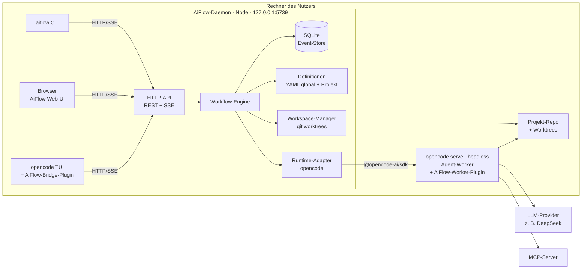
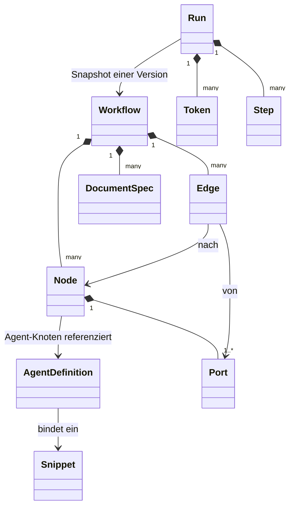
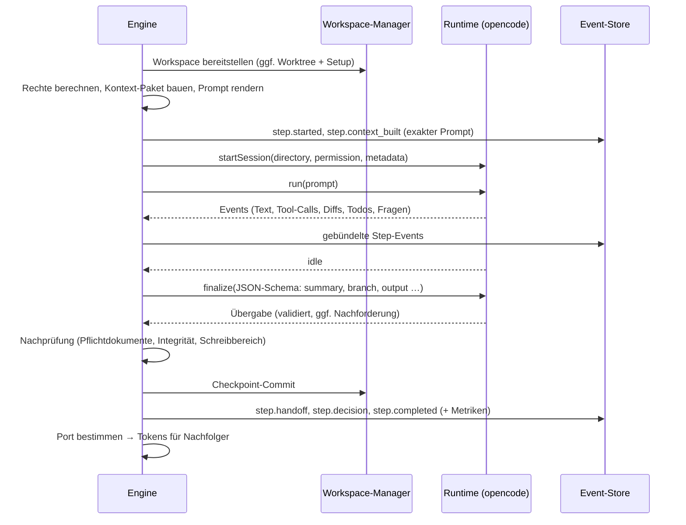
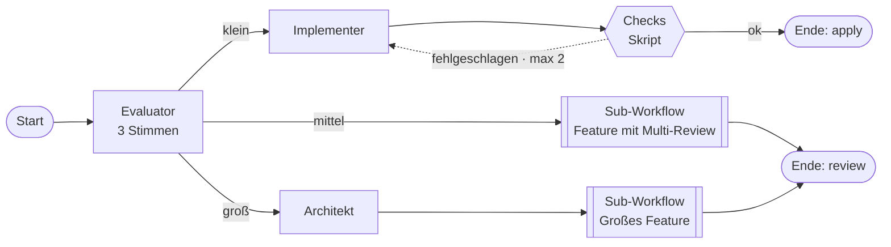
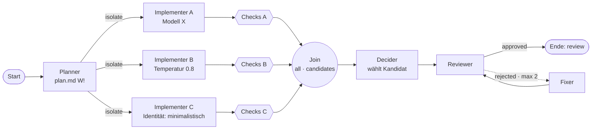
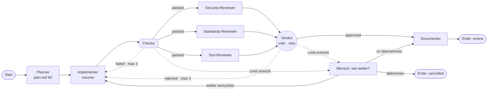
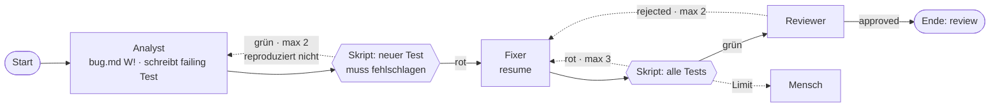
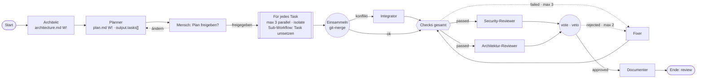

# AiFlow – Implementierungsplan

> **Status:** Entwurf v1 · **Stand:** 2026-11-07
> **Ziel-Integration:** opencode ≥ 1.19 (Plugin- und SDK-Typen `@opencode-ai/plugin` / `@opencode-ai/sdk` v1.19.5 geprüft)
> **Sprache der Umsetzung:** TypeScript

---

## Inhaltsverzeichnis

0. [Kurzfassung](#0-kurzfassung)
1. [Ziele, Nicht-Ziele, Leitprinzipien](#1-ziele-nicht-ziele-leitprinzipien)
2. [Glossar](#2-glossar)
3. [Ergänzungen gegenüber den Ausgangsideen](#3-ergänzungen-gegenüber-den-ausgangsideen)
4. [Nutzerreise von Anfang bis Ende](#4-nutzerreise-von-anfang-bis-ende)
5. [Architektur](#5-architektur)
6. [Repository-Struktur und Tech-Stack](#6-repository-struktur-und-tech-stack)
7. [Domänenmodell](#7-domänenmodell)
8. [Ausführungs-Engine](#8-ausführungs-engine)
9. [opencode-Runtime-Adapter und Worker-Plugin](#9-opencode-runtime-adapter-und-worker-plugin)
10. [opencode-Bridge-Plugin](#10-opencode-bridge-plugin)
11. [Web-UI](#11-web-ui)
12. [API und Sicherheit](#12-api-und-sicherheit)
13. [CLI](#13-cli)
14. [Qualitätssicherung und Engineering-Standards](#14-qualitätssicherung-und-engineering-standards)
15. [Roadmap: Phasen, Aufgaben, Akzeptanzkriterien](#15-roadmap-phasen-aufgaben-akzeptanzkriterien)
16. [Beispiel-Workflows](#16-beispiel-workflows)
17. [Risiken und Spikes](#17-risiken-und-spikes)
18. [Offene Entscheidungen](#18-offene-entscheidungen)
19. [Backlog / spätere Ideen](#19-backlog--spätere-ideen)

---

## 0. Kurzfassung

**AiFlow** ist eine eigenständige, lokal laufende TypeScript-Anwendung. Mit ihr baut man feste Umsetzungs-Workflows aus selbst definierten KI-Agenten und führt sie aus. opencode ist die erste Integration, aber keine harte Abhängigkeit.

| Baustein | Aufgabe |
|---|---|
| **AiFlow-Daemon** (`127.0.0.1:5739`) | Web-UI, REST/SSE-API, Workflow-Engine, Run-Historie, Definitionen |
| **Runtime-Adapter** | Führt Agenten-Schritte aus. Erste Implementierung: ein von AiFlow gestarteter, headless `opencode serve` als „Agent-Worker“. Dadurch werden Provider, Modelle, Tools, MCP-Server und das Berechtigungssystem von opencode wiederverwendet. |
| **Git-Workspace-Manager** | Isolierte Arbeitsverzeichnisse (git worktrees), Checkpoint je Schritt, Review- und Übernahme-Mechanik |
| **opencode-Bridge-Plugin** | Dünne Integration in die opencode-TUI: `/aiflow-configure`, `/aiflow-wf-<name>`, Live-Status in der Seitenleiste, Freigabe- und Review-Dialoge |

Das Ausführungsmodell ruht auf vier Ideen:

1. **Frischer, gezielter Kontext:** Jeder Agent-Schritt läuft in einer eigenen Session mit einem genau definierten Übergabe-Paket. Es gibt keinen über den ganzen Workflow wachsenden Kontext.
2. **Strukturierte Übergabe:** Jeder Schritt endet mit einer JSON-Schema-validierten Übergabe. Daraus werden Zweig-Entscheidungen, Abstimmungen und Bedingungen deterministisch ausgewertet.
3. **Eine Regel für alle Verbindungsarten:** Pro Ausführung feuert genau **ein Ausgangsport** eines Knotens. Hängen an diesem Port mehrere Kanten, laufen sie **parallel**. Sequenz, Verzweigung, Bedingung, Parallelisierung, Schleife und Fehlerpfad folgen alle aus dieser einen Regel.
4. **Volle Nachvollziehbarkeit:** Jeder Run wird per Event-Sourcing aufgezeichnet. Pro Schritt gibt es einen Git-Checkpoint, und der exakte Prompt jedes Agenten ist einsehbar.

---

## 1. Ziele, Nicht-Ziele, Leitprinzipien

### Ziele

- **Frei definierbare Agenten**: Identität, Modell, Tool- und MCP-Rechte, Dokumentzugriffe, Ausgabe-Vertrag. Es gibt keine fest vorgegebenen Rollen.
- **Visueller Workflow-Editor** per Drag & Drop mit unterschiedlichen Verbindungsarten.
- **Hohe Ergebnisqualität durch Struktur**: Planung, harte Gates (Tests, Lint, Typecheck), mehrere spezialisierte Reviewer, Best-of-N, Feedback-Schleifen. Die Qualität soll nicht davon abhängen, dass ein einzelner Modellaufruf gut ausfällt.
- **Reproduzierbare, nachvollziehbare Runs** mit History, Diffs pro Schritt und Review vor der Übernahme.
- **Unabhängigkeit**: Die Engine kennt nur ein Runtime-Interface. opencode ist der erste Adapter, die TUI-Integration nur eine Bridge.
- **Bedienbar aus der opencode-TUI, der Web-UI und der CLI** (CLI auch headless, z. B. in CI).

### Nicht-Ziele (vorerst)

- Kein Multi-User- oder Team-Server, keine Cloud. AiFlow läuft lokal für einen Nutzer.
- Kein eigener Agent-Loop und keine eigenen Datei- oder Shell-Tools in v1. Das liefert opencode.
- Kein Ersatz für CI/CD.
- Windows nur „best effort“. Linux und macOS haben Priorität.
- Projekte ohne git werden in v1 nicht unterstützt.

### Leitprinzipien

1. **Deterministische Orchestrierung, nicht-deterministische Agenten.** Die Engine trifft keine „weichen“ Entscheidungen. Sie wertet nur strukturierte Ausgaben, Regeln, Exit-Codes und Nutzerantworten aus.
2. **Explizit statt implizit.** Jede Schleife hat ein Limit, jedes Dokument hat Zugriffsrechte, und jeder parallele Zweig hat einen definierten Workspace.
3. **Sicher per Default.** Agenten arbeiten nie direkt im Arbeitsverzeichnis des Nutzers. Neue Agenten dürfen nur lesen. `git push` und Netzwerkzugriff sind standardmäßig aus.
4. **Tokens sind billig, Fehler sind teuer.** Weil der Tokenverbrauch keine Rolle spielt, setzt AiFlow bewusst auf Muster, die mehr Rechenaufwand gegen höhere Qualität tauschen: Verifikation, mehrere Reviewer, Best-of-N, mehrfache Abstimmung bei Entscheidungen.
5. **Alles ist inspizierbar.** Prompt, Kontext, Entscheidungen, Diffs und Dokumentversionen sind für jeden Schritt sichtbar.

---

## 2. Glossar

| Begriff | Bedeutung |
|---|---|
| **Agent (Definition)** | Wiederverwendbare Konfiguration: Identität, Modell, Rechte, Ausgabe-Vertrag. Liegt in der Agenten-Bibliothek. |
| **Baustein** | Wiederverwendbarer Instruktionstext, z. B. „Coding-Standards“ oder „Security-Checkliste“, den mehrere Agenten einbinden. |
| **Workflow** | Gerichteter Graph aus Knoten und Kanten plus Einstellungen, Dokumenten und Variablen. |
| **Knoten** | Element im Workflow: Start, Agent, Bedingung, Skript, Zusammenführung, Für-jedes, Mensch, Sub-Workflow, Ende, Notiz. |
| **Port** | Benannter Ausgang eines Knotens. Pro Ausführung feuert genau ein Port. |
| **Kante (Verbindung)** | Verbindet einen Port mit einem Knoten. Trägt die Übergabe-Konfiguration. |
| **Run** | Eine Ausführung eines Workflows mit konkreter Eingabe. |
| **Token** | Ein Ausführungsfaden im Run. Er trägt Position, Workspace-Referenz, Schleifenzähler und Parallel-Zuordnung. Parallele Zweige bedeuten mehrere Tokens. |
| **Schritt (Step)** | Eine Ausführung eines Knotens durch ein Token. Schritte sind die Einheit für History, Checkpoints und Retries. |
| **Übergabe (Handoff)** | Strukturiertes Ergebnis eines Schritts: Zusammenfassung, gewählter Zweig, Ausgabe, Hinweise für den Nächsten. |
| **Kontext-Paket** | Was ein Agent zu Beginn seines Schritts bekommt. Wird deterministisch aus Auftrag, Übergaben, Dokumenten, Diff und Journal zusammengesetzt. |
| **Workspace** | Arbeitsverzeichnis eines Tokens, in der Regel ein git worktree. |
| **Workflow-Dokument** | Vom Workflow definierte Datei, z. B. `plan.md`, mit Zugriffsrechten pro Knoten. |
| **Daemon** | Der AiFlow-Hauptprozess (API, Engine, UI). |
| **Worker** | Der von AiFlow gestartete `opencode serve`-Prozess, in dem die Agenten-Sessions laufen. |

---

## 3. Ergänzungen gegenüber den Ausgangsideen

Diese Punkte sind gegenüber den ursprünglichen Ideen hinzugekommen oder präzisiert worden. Sie sind an den jeweiligen Stellen im Dokument ausgearbeitet.

| Ergänzung | Warum |
|---|---|
| **Port-Semantik** als einheitliches Verbindungsmodell | Eine einfache, eindeutige Regel statt vieler Sonderfälle. Leicht zu validieren und zu visualisieren. |
| **Bedingungs-Knoten** (regelbasiert) zusätzlich zur Agent-Entscheidung | Wenn eine Entscheidung objektiv prüfbar ist, ist sie deterministisch und braucht kein LLM. |
| **Skript-Knoten** (Tests, Lint, Typecheck, Build) | Harte Qualitäts-Gates sind zuverlässiger als LLM-Urteile. Das ist der wichtigste Hebel für Codequalität. |
| **Für-jedes-Knoten** (dynamische Parallelisierung) | Der Planner erzeugt eine Aufgabenliste, und für jede Aufgabe läuft ein Implementierungs-Zweig. |
| **Join-Strategien**: alle, erster (Race), n von m; Abstimmung mit Mehrheit, einstimmig oder Veto | Deckt „3 Reviewer → gemeinsame Entscheidung“ deterministisch ab. |
| **Schleifen-Limits mit Eskalationsziel**, **Fehler-Ports** | Verhindert Endlosschleifen. Fehler werden zu modellierbaren Pfaden. |
| **Mensch-Knoten** sowie Weiterleitung von Agent-Rückfragen und Rechte-Anfragen | Human-in-the-Loop in TUI und Web-UI. |
| **Sub-Workflows** | Wiederverwendung, z. B. ein „Review-Paket“ als Baustein. |
| **Ausgabe-Verträge** (JSON-Schema) je Agent | Reviewer liefern z. B. `approved` und `findings[]` als auswertbare Daten. |
| **Kontext-Modi**: frisch, fortsetzen, fork | Steuert, ob ein Agent in einer Schleife sein Gedächtnis behält. |
| **Robuste Entscheidungen** (mehrere Stimmen, Mehrheit) | Reduziert Fehlentscheidungen schneller Modelle. Sinnvoll, weil Tokens nicht limitiert sind. |
| **Bausteine** und optionale **Rollen-Vorlagen** | Wiederverwendung ohne vorgegebene Agenten. |
| **Eingabe-Parameter** und **Variablen** je Workflow | z. B. Prüfbefehl einmal definieren, überall nutzen. |
| **Dokument-Features**: Vorlagen, Pflichtdokumente, Modus „anhängen“, Versionierung, Export ins Repo, **Zugriffs-Matrix** | Präzise Steuerung, wer was liest und schreibt. |
| **Git-Checkpoints je Schritt**, Zurückspulen, Wiederaufnahme nach Absturz | Nachvollziehbarkeit und Robustheit. |
| **Review**: Teil-Übernahme und „Änderungen anfordern“ zurück in den Workflow | Das Review wird zu einer echten Feedback-Schleife und ist nicht nur eine Ja/Nein-Entscheidung. |
| **Abschluss-Modi**: direkt, Review, Branch, Patch, nur Bericht | Passt sich an den jeweiligen Einsatzzweck an. |
| **Inbox** für offene Freigaben, Rückfragen und Reviews | Ein zentraler Ort für alles, was auf den Nutzer wartet. |
| **Simulation / Testlauf ohne LLM** und **Agent-Playground** | Workflows und Agenten testen, bevor sie teuer und langsam laufen. |
| **Globale und projektbezogene Definitionen** (`.aiflow/` im Repo) | Workflows können mit dem Team per git geteilt und versioniert werden. |
| **Workspace-Trust** | Workflows aus fremden Repos können Befehle ausführen. Sie laufen deshalb erst nach Bestätigung. |
| **CLI** (headless, CI-fähig) | Unabhängig von opencode und Web-UI nutzbar. |
| **Sicherheitskonzept** für den lokalen Daemon | Ein lokaler HTTP-Server, der Code ausführen lässt, ist ein Angriffsziel (CSRF, DNS-Rebinding). |
| **Analytics** | Workflows anhand von Daten verbessern: Schleifenquote, Fehlerknoten, Dauer. |

---

## 4. Nutzerreise von Anfang bis Ende

1. **Installation**: AiFlow installieren (`npm i -g aiflow` o. ä.) und das Bridge-Plugin in `opencode.json` eintragen.
2. **Konfigurieren**: In opencode `/aiflow-configure` ausführen. Läuft der Daemon noch nicht, wird er gestartet. Danach öffnet sich der Browser auf `http://localhost:5739` mit dem aktuellen Projekt als Kontext (Login über einen Einmal-Link).
3. **Agenten anlegen**: von Grund auf oder aus einer Vorlage. Zum Beispiel ein Planner, ein Implementer, ein Security-Reviewer, ein Standards-Reviewer und ein Documenter. Jeder bekommt Identität, Modell, Rechte, MCP-Zugriff und Ausgabe-Vertrag. Im Playground lässt sich ein Agent direkt ausprobieren.
4. **Workflow bauen**: Agenten-Kacheln aufs Canvas ziehen und Bausteine (Start, Skript, Zusammenführung, Ende …) ergänzen. Dann Ports verbinden, Zweige beschreiben, Dokumente definieren und Zugriffe in der Matrix setzen. Die Live-Validierung zeigt Probleme sofort. Ein Testlauf ohne LLM prüft die Logik.
5. **Speichern**: Der Command `/aiflow-wf-<name>` erscheint in opencode.
6. **Starten**: `/aiflow-wf-feature Passwort-Reset per E-Mail hinzufügen`. Der Prompt geht unverändert an AiFlow. Die Seitenleiste zeigt den Fortschritt: welcher Agent läuft, welche Entscheidungen fielen, welcher Schleifendurchlauf gerade aktiv ist.
7. **Mitwirken**: Wartet ein Mensch-Knoten oder hat ein Agent eine Rückfrage, erscheint ein Dialog in der TUI und eine Desktop-Benachrichtigung. Alternativ antwortet man über die Inbox im Browser.
8. **Abschluss**: Je nach Einstellung wird das Ergebnis direkt übernommen oder es erscheint ein Review. Der Review-Dialog in der TUI zeigt Kurzfassung und Dateiliste mit Änderungszählern und bietet „Übernehmen“, „Im Browser reviewen“, „Als Branch behalten“ und „Verwerfen“. Im Browser gibt es die vollständige PR-Ansicht mit Teil-Übernahme und „Änderungen anfordern“.
9. **Nachvollziehen**: In der History lässt sich jeder Run nachspielen: Graph, Zeitleiste, exakte Prompts, Entscheidungen, Diffs pro Schritt, Dokumentversionen.

---

## 5. Architektur

### 5.1 Überblick



### 5.2 Komponenten

| Komponente | Verantwortung | Kennt |
|---|---|---|
| **core** | Domänenmodell, Schemas, Graph-Validierung, Templates, Bedingungen, Run-Reducer. Kein I/O. | nichts |
| **engine** | Scheduler, Token-Logik, Kontext-Assembler, Abschluss-Phase, Joins, Limits | nur Interfaces (Ports) |
| **store** | Event-Store, Projektionen, Datei-Ablage großer Inhalte, Definitions-Repository (YAML) | core |
| **workspace-git** | Basis-Snapshots, Worktrees, Checkpoints, Diffs, Übernahme | core |
| **runtime-opencode** | Worker-Prozess, Sessions, Event-Mapping, Rechte-Mapping | core, opencode-SDK |
| **server** | HTTP, Auth, SSE, Composition Root (verdrahtet alles) | alles |
| **web** | Web-UI | client |
| **cli** | Kommandozeile | client |
| **opencode-bridge** | Integration in die TUI des Nutzers | client, opencode-Plugin-API |
| **opencode-worker-plugin** | Durchsetzung und Hilfs-Tools im Worker | opencode-Plugin-API |

### 5.3 Prozessmodell

- **Daemon**: ein Prozess pro Rechner, global für alle Projekte. Start per `aiflow serve` oder automatisch durch die Bridge. Eine Lock-Datei verhindert Doppelstarts.
- **Agent-Worker**: Der Daemon startet und überwacht einen `opencode serve` auf einem zufälligen freien Port, nur auf `127.0.0.1`. Bei einem Absturz startet er ihn mit Backoff neu. Laufende Schritte werden dann wiederholt.
  - Der Worker nutzt die normale opencode-Konfiguration des Nutzers (Provider, Auth, MCP-Server) und lädt zusätzlich das AiFlow-Worker-Plugin.
  - Sessions werden mit dem Query-Parameter `directory` auf das jeweilige Worktree gerichtet. So bedient **ein** Worker beliebig viele Projekte und Worktrees parallel.
- **Warum ein eigener Worker statt der laufenden TUI-Instanz?**
  - Runs überleben das Schließen der TUI.
  - Runs, die aus der Web-UI oder CLI gestartet werden, brauchen keine TUI.
  - Die Session-Liste des Nutzers bleibt sauber.
  - Rechte und Plugins für Agenten-Sessions sind getrennt steuerbar.
  - *Später optional:* ein „Attached Mode“, in dem Agenten-Sessions als Child-Sessions in der TUI sichtbar sind. `PluginInput.serverUrl` liefert die Adresse der TUI-Instanz.

### 5.4 Runtime-Abstraktion

Die Engine spricht nur mit diesem Interface. Die Skizze wird in Phase 2 finalisiert.

```ts
export interface AgentRuntime {
  readonly id: string; // "opencode"
  capabilities(): RuntimeCapabilities; // structuredOutput, sessionFork, permissionRules, mcp, questions …
  listModels(): Promise<ModelInfo[]>;
  listTools(): Promise<ToolInfo[]>; // inkl. MCP-Tools, für den Agenten-Editor
  startSession(spec: SessionSpec): Promise<SessionHandle>; // Verzeichnis, Rechte, Metadaten
  run(session: SessionHandle, input: PromptInput, signal: AbortSignal): AsyncIterable<RuntimeEvent>;
  finalize<T>(session: SessionHandle, req: FinalizeRequest<T>, signal: AbortSignal): Promise<FinalizeResult<T>>;
  fork(session: SessionHandle): Promise<SessionHandle>;
  answer(request: PendingRequestRef, answer: UserAnswer): Promise<void>; // Rückfragen / Rechte-Anfragen
  abort(session: SessionHandle): Promise<void>;
}
```

Spätere Adapter:

- **Direct-LLM**: OpenAI-kompatible API für reine Text-Agenten ohne Dateizugriff, z. B. Evaluator oder Decider. Schneller, weil ohne Worker-Overhead.
- **Claude Code / andere Agent-CLIs**
- **Remote-Worker**

### 5.5 Geprüfte opencode-Schnittstellen

Grundlage sind die veröffentlichten Typen von `@opencode-ai/plugin` und `@opencode-ai/sdk` in Version 1.19.5. Die Dokumentationsseite war aus der Planungsumgebung nicht erreichbar. Der Status unterscheidet deshalb zwischen „in Typen vorhanden“ und „Verhalten per Spike prüfen“ (siehe [Kapitel 17](#17-risiken-und-spikes)).

| Zweck in AiFlow | opencode-API | Status |
|---|---|---|
| Session pro Schritt im Worktree | `session.create({ query: { directory }, body: { title, parentID, agent, model, metadata, permission } })` | vorhanden |
| Prompt mit Agent-Parametern | `session.prompt` / `session.promptAsync` mit `agent, model, system, tools, variant, parts, noReply` | vorhanden; Semantik von `system` prüfen (S1) |
| Strukturierte Übergabe | `format: { type: "json_schema", schema, retryCount }` | vorhanden; Zuverlässigkeit mit DeepSeek V4.1 Flash prüfen (S3) |
| Rechte pro Session | `permission: PermissionRule[]` mit `{ permission, pattern, action }` | vorhanden; Muster-Semantik prüfen (S2) |
| Self-Consistency / Kontext-Modus „fork“ | `session.fork` | vorhanden |
| Abbruch | `session.abort` | vorhanden |
| Live-Events | `event.subscribe()` (SSE), u. a. `session.status`, `session.idle`, `session.error`, `session.diff`, `message.part.updated`, `message.part.delta`, `todo.updated`, `permission.asked`, `question.asked` | vorhanden |
| Rückfragen und Rechte-Anfragen beantworten | `question.reply` / `question.reject`, `permission.reply` | vorhanden |
| Daten für den Agenten-Editor | `provider.list`, `mcp.status`, `tool.ids` / `tool.list`, `app.agents`, `config.get` | vorhanden |
| Plugin-Hooks (Server) | `config`, `event`, `tool` (eigene Tools; `context` liefert `sessionID, directory, worktree, abort, metadata(), ask()`), `tool.execute.before/after`, `permission.ask`, `shell.env`, `chat.params`, `command.execute.before`, `experimental.session.compacting` | vorhanden |
| TUI-Plugin | Slots (`sidebar_content`, `sidebar_footer`, `session_prompt_right`, `app_bottom`, `home_bottom`), eigene Routen, Dialoge (`DialogSelect/Prompt/Confirm/Alert`), `ui.toast`, `attention.notify` (Desktop-Benachrichtigung und Sound), Keymap-Commands mit Slash-Namen, `event.on`, `kv`, `client` | vorhanden; Slash-Commands mit Argumenten prüfen (S6) |
| Dynamische Commands ohne Neustart | v2-Plugin-API `command.transform` + `reload()` (experimentell) | vorhanden, experimentell |

---

## 6. Repository-Struktur und Tech-Stack

### 6.1 Struktur

```
plugins/aiflow/
├── PLAN.md                       # dieses Dokument
├── AGENTS.md                     # Regeln für KI-Agenten, die an AiFlow arbeiten (Phase 0)
├── README.md
├── package.json                  # pnpm-Workspace-Root: check, test, build, dev
├── pnpm-workspace.yaml
├── tsconfig.base.json
├── eslint.config.js
├── .dependency-cruiser.cjs       # erzwingt Paketgrenzen
├── docs/
│   ├── adr/                      # Architecture Decision Records
│   └── architecture.md
├── examples/
│   ├── agents/  workflows/  snippets/   # Beispiel-Definitionen = Test-Fixtures
│   └── demo-repo/                # kleines Repo für Integrations- und E2E-Tests
└── packages/
    ├── core/                     # Domänenmodell (Zod), Validierung, Templates, Bedingungen, Reducer
    ├── engine/                   # Orchestrierung gegen Interfaces
    ├── store/                    # SQLite-Event-Store, Projektionen, YAML-Repository
    ├── workspace-git/            # Worktrees, Snapshots, Checkpoints, Diffs, Übernahme
    ├── runtime-opencode/         # AgentRuntime für opencode + Worker-Prozessverwaltung
    ├── opencode-worker-plugin/   # Plugin im Worker: Guards, Hilfs-Tools, Env
    ├── server/                   # Hono-App, Auth, SSE, statische Web-UI, Composition Root
    ├── client/                   # typisierter API-Client (web, cli, bridge)
    ├── cli/                      # `aiflow`
    ├── web/                      # React-Web-UI
    ├── opencode-bridge/          # Plugin für die opencode-Instanz des Nutzers (Server- + TUI-Modul)
    └── testkit/                  # FakeRuntime, In-Memory-Store, Temp-Git-Repos, Fixtures
```

**Abhängigkeitsregeln** (in CI per dependency-cruiser erzwungen):

- `core` hängt von keinem anderen Paket ab, nur von `zod` und kleinen Pure-Libs.
- `engine` hängt nur von `core` und eigenen Interfaces ab. Es kennt weder SQLite noch git noch opencode.
- `store`, `workspace-git` und `runtime-opencode` hängen von `core` ab und implementieren die Ports der Engine.
- `server` ist die einzige Stelle, die alles zusammensteckt.
- `client` hängt nur von `core` ab (Typen und Schemas). `web`, `cli` und `opencode-bridge` nutzen ausschließlich `client`.
- `opencode-bridge` und `opencode-worker-plugin` dürfen keine Node-only-Abhängigkeiten haben, weil sie in der Bun-Runtime von opencode laufen.

### 6.2 Tech-Stack

| Bereich | Wahl | Begründung |
|---|---|---|
| Sprache | TypeScript 5.x, `strict`, `noUncheckedIndexedAccess`, `exactOptionalPropertyTypes` | Maximale Typsicherheit |
| Runtime Daemon/CLI | Node.js 24 LTS (Code bleibt Bun-kompatibel) | Verbreitet und stabil. opencode-Plugins laufen ohnehin in Bun, der Daemon soll aber nicht davon abhängen. |
| Paketmanager | pnpm Workspaces | Schnell, strikt, gut für Monorepos |
| Build | tsdown (Pakete), Vite (Web) | Einfach und schnell |
| HTTP | Hono + `@hono/node-server`, `@hono/zod-openapi` | Läuft auf Node und Bun. OpenAPI wird aus denselben Schemas erzeugt. |
| Echtzeit | Server-Sent Events mit `Last-Event-ID`-Resume | Einfacher als WebSockets, reicht für Server-zu-Client-Streams |
| Validierung | Zod 4 an allen Grenzen; JSON-Schema-Export für Ausgabe-Verträge | Dieselben Schemas in API, Dateien, Formularen und Runtime |
| Persistenz | SQLite (`better-sqlite3`) + Drizzle ORM + drizzle-kit-Migrationen | Lokal, transaktional, ohne Server |
| Definitionen | YAML (`yaml` von eemeli, erhält Kommentare) | Gut lesbar, git-freundlich, reviewbar |
| Git | System-`git` über `execa`, typisierte Wrapper | Volle Funktionalität (worktrees, merge-tree). Keine native Abhängigkeit. |
| Bedingungen | JSON Logic | Serialisierbar und sicher (kein `eval`), im UI per Regel-Builder erzeugbar |
| Templates | Logikloses Mustache-artiges Rendering, strikt | Unbekannte Variablen sind Validierungsfehler. Keine Code-Ausführung. |
| Web-UI | React 19, Vite, TanStack Router + Query, `@xyflow/react` (Canvas), elkjs (Auto-Layout), Zustand + zundo (Undo/Redo), shadcn/ui + Tailwind, Monaco (Prompts, Schemas, YAML, Diffs), react-hook-form + Zod, i18next (de/en) | Bewährte Bausteine für node-basierte Editoren |
| TUI-Plugin | `@opencode-ai/plugin/tui` mit `@opentui/solid` | Offizielle TUI-Plugin-API von opencode |
| Logging | pino (JSON), eigene Logdatei pro Run | Strukturierte Logs mit Korrelations-IDs |
| Tests | Vitest, Playwright | Schnell, TS-nativ |
| Codequalität | ESLint (`typescript-eslint` strictTypeChecked), Prettier, dependency-cruiser, knip, lefthook | Automatisch durchgesetzte Standards |
| Pfade | `env-paths` | XDG- und macOS-konforme Daten- und Konfigurationsordner |

---

## 7. Domänenmodell

### 7.1 Überblick



### 7.2 Agent-Definition

| Gruppe | Feld | Beschreibung |
|---|---|---|
| **Identität** | Name, ID (Slug) | ID ist eindeutig im Scope (global oder Projekt) |
| | Beschreibung | Kurztext. Erscheint in der Palette und wird anderen Agenten gezeigt, z. B. bei Übergaben. |
| | Tags / Rolle | Frei wählbar (planner, review, security …), nur zur Organisation |
| | Icon und Farbe | Darstellung der Kachel |
| | Identität (System-Prompt) | Markdown mit Template-Variablen: Rolle, Haltung, Arbeitsweise, Qualitätsmaßstäbe, Verbote |
| | Bausteine | Eingebundene wiederverwendbare Instruktionen, z. B. Coding-Standards |
| | Projekt-Instruktionen | `AGENTS.md` und Projektregeln einbeziehen (Standard: an) |
| **Modell** | Modell | Provider und Modell aus opencode (`provider.list`). Leer bedeutet Workflow- oder globaler Standard. |
| | Variante / Reasoning | z. B. `high` (opencode `variant`) |
| | Temperatur, top_p | Optional |
| | Max. Schritte | Maximale Tool-Call-Iterationen (opencode `steps`) |
| | Timeout | Pro Schritt |
| **Werkzeuge und Rechte** | Preset | „Nur lesen“, „Implementieren“, „Voll“, danach individuell anpassbar |
| | Regeln je Tool | `read, edit, glob, grep, list, bash, webfetch, websearch, task, todowrite, lsp, skill, question` jeweils `allow` / `ask` / `deny`, mit Mustern (z. B. bash `git push*` → deny, `pnpm test*` → allow) |
| | Rückfragen erlaubt | Darf der Agent den Nutzer fragen? (opencode-`question`-Tool) |
| **MCP und Skills** | MCP-Server/-Tools | Auswahl aus `mcp.status`, pro Server an oder aus, pro Tool allow oder deny |
| | Skills | Erlaubte opencode-Skills |
| **Ausgabe** | Ausgabe-Vertrag | „Freitext“ oder JSON-Schema (visueller Builder für einfache Felder, Experten-Modus als JSON), z. B. `approved: boolean`, `findings[]`, `size: enum` |
| | Übergabe-Hinweise | Was dieser Agent standardmäßig an den Nächsten weitergibt |
| **Verhalten** | Kontext-Modus (Standard) | `fresh` / `resume` / `fork` (siehe 7.9) |
| | Retries | Bei Fehler, Timeout oder ungültiger Übergabe |
| | Entscheidungs-Stimmen | n ≥ 1 (Self-Consistency, siehe 8.5) |
| **Dokumente** | Standard-Zugriffe | Vorschläge, im Workflow überschreibbar |
| **Meta** | Scope, Version, Änderungsdatum | Versionierung über Inhalts-Hash |

**Rechte-Presets:**

| Preset | Inhalt |
|---|---|
| Nur lesen *(Standard für neue Agenten)* | `read/glob/grep/list/lsp`: allow · `edit`: deny · `bash`: deny außer Allowlist (`git diff*`, `git log*`, `git show*`, `git status*`) · Netz: deny · `task`: deny |
| Implementieren | Wie „Nur lesen“, zusätzlich `edit`: allow (nur im Workspace) und `bash`: allow mit Denylist (`git push*`, `git reset --hard*`, `git checkout*`, `rm -rf /*`, `sudo*` …). Unbekannte Netz-Tools: ask. |
| Voll | Alles allow außer `task` und `git push*` |

`external_directory` ist immer `deny`, mit Ausnahme des Dokument-Ordners des Runs und (nur lesend) der Kandidaten-Worktrees nach einem Join. `task` (Sub-Agenten von opencode) ist standardmäßig aus, weil AiFlow orchestriert.

### 7.3 Bausteine (Snippets)

- Wiederverwendbare Markdown-Texte mit Name, Beschreibung und Inhalt, optional mit Template-Variablen.
- Typische Beispiele: „Coding-Standards des Teams“, „Security-Checkliste (OWASP)“, „Definition of Done“, „Commit-Konventionen“, „Ausgabeformat für Review-Befunde“.
- Agenten binden Bausteine ein. Eine Änderung am Baustein wirkt auf alle Agenten, die ihn nutzen. Die Versionierung erfolgt über den Run-Snapshot.
- Dazu gehören auch **Dokument-Vorlagen**, z. B. die Gliederung für `plan.md`.

### 7.4 Rollen-Vorlagen (optional)

Es gibt keine vorgegebenen Agenten. Eine Vorlagen-Galerie hilft aber beim Start. Eine Vorlage wird beim Anlegen **kopiert** und gehört danach dem Nutzer.

| Vorlage | Kern |
|---|---|
| Anforderungs-Analyst | Präzisiert den Auftrag, listet Annahmen und offene Fragen (Rückfragen erlaubt) |
| Evaluator / Triage | Klassifiziert Aufgaben, z. B. nach Größe, Risiko oder Bereich (nur lesen, Entscheidung) |
| Architekt | Entwirft Struktur, Schnittstellen und Datenmodell, schreibt `architecture.md` |
| Planner | Zerlegt in Teilschritte mit Akzeptanzkriterien, schreibt `plan.md`, liefert `tasks[]` |
| Implementer | Setzt um, schreibt Tests, hält sich an den Plan |
| Test-Writer | Schreibt Tests vorab oder ergänzend (TDD-Workflows) |
| Debugger / Fixer | Reproduziert Fehler, findet die Ursache, behebt sie minimal |
| Refactorer | Verbessert Struktur ohne Verhaltensänderung |
| Verifier | Prüft Akzeptanzkriterien gegen die Umsetzung, Ausgabe `approved` und `gaps[]` |
| Reviewer-Varianten | Security, Code-Standards, Architektur/Design, Performance, Testqualität, Barrierefreiheit (UI). Jeweils nur lesen, Ausgabe `approved` und `findings[]`. |
| Decider / Judge | Wählt unter Kandidaten mit Begründung |
| Integrator / Merger | Führt parallele Ergebnisse zusammen und löst Konflikte |
| Documenter / Writer | Schreibt Doku, Changelog, Commit- und PR-Text |
| Researcher | Recherchiert (Web/MCP erlaubt), schreibt Notizen, nur lesen im Repo |

### 7.5 Workflow

| Feld | Beschreibung |
|---|---|
| Name, ID | ID ist eindeutig im Scope |
| Command-Name | Ergibt `/aiflow-wf-<name>`. Validiert als gültiger Command-Name. |
| Beschreibung | Erscheint in der opencode-Command-Liste und in der Web-UI |
| Eingaben | `prompt` (Pflicht) plus optionale Parameter (Text, Zahl, Boolean, Auswahl) mit Label, Standardwert und Pflicht-Flag. Daraus entstehen Formulare in Web-UI und TUI. |
| Variablen | Konstanten, z. B. `checkCommand: pnpm typecheck && pnpm lint && pnpm test` |
| Standard-Modell | Fallback für Agenten ohne eigenes Modell |
| Workspace | Basis (`working-tree` / `head` / `branch:<name>`), Setup-Befehl, Aufbewahrung |
| Dokumente | Siehe 7.10 |
| Limits | Max. Schritte, max. Dauer, max. parallele Sessions, Standard-Schleifenlimit |
| Abschluss-Standard | Siehe 7.12 |
| Benachrichtigungen | Wann der Nutzer informiert wird |
| Knoten, Kanten, Layout | Der Graph und die Canvas-Positionen |

### 7.6 Knotentypen

| Knoten | Zweck | Ausgangsports | Wichtigste Einstellungen |
|---|---|---|---|
| **Start** | Einstieg, nimmt Prompt und Parameter an | `weiter` | Eingabe-Formular |
| **Agent** | Führt einen Agenten aus | `weiter` **oder** benutzerdefinierte Zweige; optional `fehler` | Agent-Referenz, Overrides (Modell, Zusatzanweisung), Zweige, Workspace, Dokumente, Kontext-Modus, Limits, Stimmen |
| **Bedingung** | Deterministische Verzweigung | Benannte Regeln + `sonst` | JSON-Logic-Regeln über den Run-Kontext |
| **Skript** | Führt einen Befehl aus (Tests, Lint, Typecheck, Build, Formatter, Codegen) | `ok` / `fehlgeschlagen` oder eigene Regeln über Exit-Code und Ausgabe; optional `fehler` | Befehl (Template), Timeout, Umgebung, Kürzung der Ausgabe (Kopf und Ende) |
| **Zusammenführung (Join)** | Wartet auf parallele Zweige und kombiniert sie | `weiter` oder Abstimmungsports (z. B. `approved` / `rejected`) | Warte-Strategie, Kombinations-Strategie, Workspace-Strategie (7.8) |
| **Für jedes (Map)** | Dynamische Parallelisierung über eine Liste | `weiter` (nach dem Einsammeln), `fehler` | Quelle (z. B. `node.plan.output.tasks`), max. Parallelität, Rumpf als Agent oder Sub-Workflow, Workspace je Element, Einsammel-Strategie wie beim Join |
| **Mensch** | Freigabe oder Eingabe durch den Nutzer | Benannte Antworten (z. B. `freigegeben` / `ändern` / `abbrechen`) | Frage (Template), Optionen, Freitext erlaubt, Timeout mit Standardantwort |
| **Sub-Workflow** | Ruft einen anderen Workflow als Schritt auf | Ein Port je Ende-Knoten des Sub-Workflows | Workflow-Referenz, Eingabe-Mapping, Workspace-Übergabe |
| **Ende** | Abschluss | – | Ergebnis (`success` / `rejected` / `failed` / `cancelled`), Abschluss-Modus, Bericht-Template, Dokument-Export |
| **Notiz / Rahmen** | Nur Dokumentation und Gruppierung auf dem Canvas | – | Text, Farbe |

### 7.7 Ports und Verbindungen

**Kernregel:**

1. Jeder Knoten (außer Ende und Notiz) hat einen oder mehrere **Ausgangsports**.
2. Pro Ausführung feuert **genau ein** Port. Welcher, bestimmt der Knotentyp: der einzige Port, die Agent-Entscheidung, die Bedingungsregel, der Exit-Code, die Abstimmung, die Nutzerantwort oder der Fehler.
3. **Alle Kanten am feuernden Port werden gleichzeitig aktiviert.** Mehrere Kanten an einem Port bedeuten Parallelisierung.
4. Parallel gestartete Zweige werden über einen **Join** wieder eingesammelt, oder jeder Zweig endet in einem eigenen Ende-Knoten.
5. Eine Kante zu einem bereits durchlaufenen Knoten ist eine **Schleife** und braucht ein **Limit** mit Eskalationsziel.

**Verbindungsarten, wie der Nutzer sie im UI sieht:**

| Verbindungsart | Modellierung | Beispiel |
|---|---|---|
| **Direkt (Sequenz)** | 1 Port → 1 Kante | Planner → Implementer |
| **Verzweigung (Agent entscheidet)** | Agent-Knoten mit n Zweig-Ports. Jeder Zweig hat Name, **Beschreibung „wann wählen“** und **Übergabe-Anweisung**. | Evaluator → klein / mittel / groß; Verifier → approved / nicht approved |
| **Bedingung (regelbasiert)** | Bedingungs- oder Skript-Knoten mit Regel-Ports + `sonst` | Befunde mit `severity = critical` vorhanden → Fixer |
| **Parallel (Fan-out)** | 1 Port → n Kanten | Planner → 3 Implementer; Implementer → 3 Reviewer |
| **Dynamisch parallel** | Für-jedes-Knoten | Plan mit 5 Teilaufgaben → 5 Implementer |
| **Zusammenführung (Fan-in)** | Join-Knoten | 3 Reviewer → Join (Veto) → approved / rejected |
| **Wettlauf (Race)** | Join mit „erster gewinnt“ | Zwei Lösungsansätze, der erste mit grünen Tests gewinnt, der andere wird abgebrochen |
| **Schleife / Feedback** | Kante zurück, mit `max` und `onExceeded` | Reviewer „nicht approved“ → Implementer (max. 3, dann Mensch) |
| **Fehlerpfad** | `fehler`-Port | Implementer scheitert wiederholt → Debugger oder Mensch |
| **Eskalation an den Menschen** | Kante zu einem Mensch-Knoten | Nach 3 Fehlversuchen entscheidet der Nutzer |
| **Sub-Workflow** | Sub-Workflow-Knoten | „Security-Review-Paket“ als wiederverwendbarer Baustein |

**Eigenschaften einer Kante:**

| Eigenschaft | Beschreibung |
|---|---|
| Label | Standard ist der Portname |
| **Übergabe-Anweisung** | Was der Sender für diesen Weg mitgeben soll. Der Sender sieht sie in seiner Abschluss-Phase, der Empfänger als Überschrift seines Kontexts. Beispiel: „Liste jeden Mangel mit Datei, Zeile und konkretem Änderungsvorschlag.“ |
| **Kontext-Paket** | Welche Inhalte der Empfänger bekommt (siehe 7.9). Standardwerte kommen vom Workflow, pro Kante überschreibbar. |
| **Workspace-Übergabe** | `continue` (weiterarbeiten) / `isolate` (eigene Kopie) / `read-only` / `scratch` (leeres Verzeichnis) |
| **Schleifen-Limit** | Nur bei Rückkanten und dort Pflicht: `max`, `onExceeded` (Zielknoten), optional `resetLoopCounters` |

**Darstellung im Editor:** Zweig-Ports erscheinen als beschriftete Handles am Knoten. Mehrere Kanten an einem Handle zeigen ein Fork-Symbol. Rückkanten sind gestrichelt und tragen einen Zähler (z. B. „max. 3“). Fehlerkanten sind rot.

### 7.8 Zusammenführung (Join)

**Zuordnung:** Ein Join gehört zu genau einem Fan-out. Die Zuordnung wird automatisch ermittelt und validiert (strukturierte Parallelität, siehe 8.3).

**Warte-Strategie:**

| Strategie | Verhalten |
|---|---|
| `all` | Wartet auf alle Zweige |
| `first` | Der erste fertige Zweig gewinnt, die übrigen werden abgebrochen (Race) |
| `first-matching` | Der erste Zweig, der eine Bedingung erfüllt (z. B. Checks grün), gewinnt |
| `n-of-m` | Weiter, sobald n Zweige fertig sind. Der Rest läuft optional weiter oder wird abgebrochen. |
| Timeout | Danach mit vorhandenen Ergebnissen weitermachen oder `fehler` |

**Kombination der Ergebnisse:**

| Strategie | Verhalten |
|---|---|
| `collect` | Alle Übergaben und Ausgaben gehen als Liste an den Nachfolger, z. B. an einen Decider |
| `vote` | Wertet ein Feld der strukturierten Ausgaben aus, z. B. `output.approved`. Regeln: `majority`, `unanimous`, `veto` (ein Nein reicht für Nein), `weighted`. Erzeugt Ports nach Ergebnis. Das **Feedback aller Gegenstimmen** wird zu einem Paket zusammengeführt, z. B. als Liste aller Befunde nach Schweregrad. |
| `synthesize` | Ein am Join konfigurierter Agent fasst zusammen oder entscheidet. Das ist eine kompakte Form von „Join → Decider“. |

**Workspace-Strategie:**

| Strategie | Verhalten | Typischer Fall |
|---|---|---|
| `keep-base` | Die Zweige haben nur gelesen, der Basis-Workspace läuft weiter | Parallele Reviewer |
| `candidates` | Alle Zweig-Workspaces bleiben als Kandidaten erhalten. Der nächste Agent bekommt sie lesend und wählt per strukturierter Ausgabe `selectedCandidate` (das Schema-Feld wird automatisch ergänzt). Die Engine führt den gewählten Workspace weiter. | Best-of-3-Implementierung |
| `git-merge` | Die Zweig-Branches werden zusammengeführt. Bei einem Konflikt feuert der `konflikt`-Port, z. B. hin zu einem Integrator-Agenten. | Für-jedes über unabhängige Teilaufgaben |

### 7.9 Kontext und Übergabe

**Kontext-Modi eines Agent-Knotens:**

| Modus | Verhalten | Einsatz |
|---|---|---|
| `fresh` *(Standard)* | Neue Session, nur das Kontext-Paket | Fast immer: fokussierter, reproduzierbarer Kontext |
| `resume` | Beim erneuten Besuch desselben Knotens (Schleife) wird die eigene Session mit einer neuen Nachricht fortgesetzt, z. B. mit Feedback | Ein Implementer, der seine eigene Arbeit kennt und nur nachbessert |
| `fork` | Die Session des Vorgängers wird geforkt; der Agent sieht dessen vollständigen Verlauf | Selbstprüfung direkt nach der Implementierung |

**Kontext-Paket (konfigurierbar pro Kante, Standardwerte pro Workflow):**

| Inhalt | Standard |
|---|---|
| Ursprünglicher Auftrag des Nutzers (unverändert) | an |
| Workflow-Ziel und Position (Knoten, Schritt, Durchlauf x von max. y) | an |
| Übergabe des Vorgängers: Zusammenfassung | an |
| Übergabe des Vorgängers: Details, strukturierte Ausgabe | an |
| Feedback (bei Rückkanten: z. B. Reviewer-Befunde, Skript-Ausgabe) | an |
| Ablauf-Journal (kompakte Liste aller bisherigen Schritte und Entscheidungen) | an, gekürzt |
| Workspace-Diff seit Run-Start: `none` / `stat` / `full` | `stat` |
| Dokumente: Liste mit Pfad, Zweck und Recht; optional der Inhalt direkt eingebettet | Liste an |
| Kandidaten (nach Join mit `candidates`) | an |

**Aufbau des Prompts:** Der Kontext-Assembler baut ihn deterministisch. Er wird als Event gespeichert und ist in der Run-Ansicht exakt einsehbar.

```markdown
# AiFlow · Workflow „Feature mit Multi-Review“ · Schritt 7 · Knoten „implement“ · Durchlauf 2 von max. 3

## Auftrag des Nutzers
Füge Passwort-Reset per E-Mail hinzu …

## Deine Aufgabe in diesem Schritt
<Zusatzanweisung des Knotens bzw. Standard aus der Agent-Beschreibung>

## Bisheriger Ablauf
1. plan (Planner): Plan mit 6 Teilschritten erstellt → plan.md
2. implement (Implementer): Endpunkte und Service umgesetzt
3. checks: fehlgeschlagen (2 Tests) → zurück zu implement
4. …

## Übergabe von „verdict“ (Zweig: rejected)
Anweisung: Arbeite alle Befunde mit Schweregrad ≥ medium ab.
<zusammengeführtes Feedback der Reviewer>

## Dokumente
- plan.md · lesen · /…/runs/r_8f2/docs/plan.md · Umsetzungsplan mit Akzeptanzkriterien
- review.md · lesen · /…/runs/r_8f2/docs/review.md · Gesammelte Review-Befunde

## Arbeitsumgebung
Arbeitsverzeichnis: /…/worktrees/…/t_3 (isoliert, schreibbar)
Änderungen seit Run-Start: 9 Dateien, +412 / −37

## Abschluss
Arbeite selbstständig, bis die Aufgabe vollständig erledigt ist.
Danach wirst du um eine strukturierte Übergabe gebeten.
```

**Nachschlagen statt Vollstopfen:** Ältere Übergaben, Ausgaben und Dokumentversionen kann der Agent bei Bedarf über das Tool `aiflow_context` abrufen. Der Prompt bleibt dadurch klein, die Tiefe ist trotzdem verfügbar.

### 7.10 Workflow-Dokumente

**Definition auf Workflow-Ebene:**

| Feld | Beschreibung |
|---|---|
| Name | z. B. `plan.md`, `verification.md`, `decisions.json` |
| Zweck | Wird den Agenten angezeigt |
| Format | `markdown` / `text` / `json` (mit JSON-Schema, gegen das validiert wird) |
| Vorlage | Startinhalt bzw. Gliederung |
| Pflicht am Ende | Run schlägt fehl bzw. fordert nach, wenn das Dokument fehlt oder leer ist |
| Export | Bei Abschluss ins Repo übernehmen, mit Pfad-Template, z. B. `docs/plans/{{run.date}}-{{run.slug}}.md` |
| Im Review zeigen | Erscheint in der Review-Ansicht |

**Zugriffsrechte pro Knoten:**

| Recht | Bedeutung | Prüfung |
|---|---|---|
| `–` | Kein Zugriff, Dokument ist unsichtbar | Lesen und Schreiben blockiert |
| `R` (lesen) | Nur lesen | Schreiben blockiert, Integritätsprüfung |
| `A` (anhängen) | Nur ergänzen, z. B. für mehrere Reviewer in `review.md` | Neuer Inhalt muss mit dem alten beginnen |
| `W` (schreiben) | Lesen und Schreiben | – |
| `W!` (muss schreiben) | Schreiben ist Pflicht in diesem Schritt | Unverändert → Nachforderung, dann `fehler` |

**Zugriffs-Matrix im Editor:** Zeilen sind Knoten, Spalten sind Dokumente, die Zellen sind per Klick umschaltbar.

```
                plan.md   review.md   decisions.json
Planner          W!          –            W
Implementer      R           R            R
Security-Rev.    R           A            –
Standards-Rev.   R           A            –
Documenter       R           R            R
```

**Technische Umsetzung:**

- **Speicherort:** `<data>/runs/<runId>/docs/`, also **außerhalb** der Worktrees. Dadurch gibt es keine Kopien und Konflikte zwischen parallelen Zweigen, und die Dokumente landen nicht im Code-Diff.
- **Zugriff:** Agenten nutzen ihre normalen Datei-Tools mit dem absoluten Pfad aus dem Kontext-Paket. Das ist robuster als Spezial-Tools.
- **Durchsetzung in drei Stufen:**
  1. Das Session-Permission-Ruleset (`read` / `edit` / `external_directory` mit Pfadmustern).
  2. Das Worker-Plugin blockiert in `tool.execute.before` unerlaubte Zugriffe hart, mit einer verständlichen Fehlermeldung an den Agenten.
  3. Eine Integritätsprüfung nach jedem Schritt (Hash-Vergleich). Unerlaubte Änderungen, z. B. über `bash`, werden zurückgesetzt und als Warn-Event protokolliert.
- **Versionierung:** Nach jedem Schritt mit Schreibrecht wird ein Snapshot gespeichert. Die Run-Ansicht zeigt den Versionsverlauf mit Diff.
- **Parallelität:** Dürfen zwei parallele Zweige dasselbe Dokument schreiben (`W`), ist das ein Validierungsfehler. Erlaubt ist nur `A`; die Anhänge werden dann in fester Reihenfolge zusammengeführt.

### 7.11 Arbeitsverzeichnisse (Workspaces)

**Grundprinzip:** Agenten arbeiten nie direkt im Arbeitsverzeichnis des Nutzers. Jeder Run hat einen eigenen Workspace, und jedes Token trägt eine Workspace-Referenz (Worktree-Pfad und aktueller Commit).

- **Basis-Snapshot:** Beim Run-Start wird der aktuelle Stand des Nutzer-Arbeitsverzeichnisses als Commit-Objekt festgehalten, **inklusive uncommitted und untracked Dateien** (ohne ignorierte). Index und Arbeitsverzeichnis des Nutzers bleiben dabei unberührt. Technik: temporärer Index, d. h. `GIT_INDEX_FILE=<tmp> git add -A`, dann `git write-tree` und `git commit-tree`. Alternativ kann die Basis `HEAD` oder ein Branch sein.
- **Versteckte Refs:** Alle Run-Commits liegen unter `refs/aiflow/runs/<runId>/…`. Sie tauchen nicht in `git branch` auf, sind aber vor Garbage Collection geschützt.
- **Speicherort:** `<data>/worktrees/<projekt-hash>/<runId>/<tokenId>`, außerhalb des Repos. So gibt es keine Störungen durch Datei-Watcher, IDE-Indexer oder Test-Runner.

**Workspace-Modi** pro Agent-Knoten, als Standard über die Kante überschreibbar:

| Modus | Verhalten |
|---|---|
| `continue` *(Standard)* | Arbeitet im Workspace des eingehenden Tokens weiter |
| `isolate` | Neues Worktree ab dem aktuellen Commit des Vorgängers. **Pflicht** für parallele, schreibende Zweige (der Validator erzwingt das). |
| `read-only` | Workspace des Vorgängers ohne Schreibrecht. Parallele Reviewer teilen sich einen Workspace. |
| Schreibbereich | Zusätzlich zu `continue` oder `isolate`: Schreibrecht nur für Pfadmuster, z. B. `docs/**` für den Documenter oder `packages/api/**` |
| `scratch` | Leeres temporäres Verzeichnis für Recherche oder Prototypen ohne Repo-Bezug |
| `external` | Expliziter Pfad, z. B. ein anderes Repo. Nur nach Bestätigung (Workspace-Trust). |

**Weitere Mechanik:**

- **Checkpoints:** Nach jedem Schritt wird im Worktree committet (`aiflow: <knoten> · Schritt <n>`). Daraus ergeben sich Diffs pro Schritt, Zurückspulen und Wiederaufnahme nach einem Absturz.
- **Grenzprüfung:** Nach jedem Schritt prüft AiFlow, ob der Diff nur erlaubte Pfade betrifft. Bei einem Verstoß folgt eine Nachforderung oder ein Fehler.
- **Setup-Befehl** pro Workflow oder Projekt, z. B. `pnpm install --frozen-lockfile --prefer-offline`. Er läuft nach jeder Worktree-Erzeugung. Der pnpm-Store macht das per Hardlinks schnell. Optional gibt es den Modus „node_modules verlinken“: schnell, aber nur sicher bei identischem Lockfile.
- **Aufräumen:** Nach Abschluss werden die Worktrees entfernt. Die Refs bleiben für die History erhalten, bis der Run gelöscht wird. Die Aufbewahrung ist konfigurierbar (Standard: 14 Tage).

### 7.12 Abschluss (Ende-Knoten)

**Abschluss-Modi:**

| Modus | Verhalten |
|---|---|
| `apply` (direkt übernehmen) | Der Diff von Basis zu Ergebnis wird per 3-Wege-Merge ins Arbeitsverzeichnis des Nutzers übernommen. Bei Konflikten fällt AiFlow automatisch auf `review` zurück. |
| `review` (PR-Ansicht) | Der Run wartet im Zustand „Review ausstehend“. Die Entscheidung fällt in der Web-UI oder im TUI-Dialog. |
| `branch` | Das Ergebnis wird als normaler Branch `aiflow/<workflow>/<datum>-<kurz-id>` angelegt, optional mit einer Commit-Nachricht aus einer Agent-Ausgabe. Weiter geht es über den klassischen PR-Weg. |
| `patch` | Export als `.patch`-Datei |
| `none` (nur Bericht) | Kein Code-Ergebnis, z. B. bei Analyse- und Recherche-Workflows |

Dazu kommen ein **Abschlussbericht** (Template; Standard: Zusammenfassung, Entscheidungen, geänderte Dateien, offene Punkte, Dokumente), der **Dokument-Export** ins Repo und das **Ergebnis** (`success` / `rejected` / `failed` / `cancelled`). Mehrere Ende-Knoten sind erlaubt, z. B. „Ende: umgesetzt“ und „Ende: abgelehnt“.

**Review-Aktionen:**

| Aktion | Wirkung |
|---|---|
| Alles übernehmen | 3-Wege-Übernahme |
| Auswahl übernehmen | Pro Datei, später auch pro Hunk |
| **Änderungen anfordern** | Kommentare und allgemeines Feedback werden zu einer Übergabe. Der Run läuft ab einem konfigurierbaren Knoten weiter (Standard: der letzte schreibende Agent-Knoten). Es gelten die Limits. |
| Als Branch behalten | Wie Modus `branch` |
| Verwerfen | Run-Ergebnis `rejected`, Worktrees werden aufgeräumt |

**Konflikterkennung:** Hat der Nutzer seit dem Run-Start dieselben Dateien geändert, werden sie markiert. Die Übernahme läuft als 3-Wege-Merge (`git merge-tree` bzw. `git apply --3way`) mit Konfliktanzeige.

### 7.13 Variablen, Templates, Bedingungen

**Namensraum** für Templates (Prompts, Fragen, Befehle, Pfade) und Bedingungen:

| Variable | Inhalt |
|---|---|
| `input.prompt`, `input.<param>` | Eingaben des Runs |
| `vars.<name>` | Workflow-Variablen |
| `run.id`, `run.date`, `run.slug`, `run.workflow` | Run-Metadaten |
| `node.<id>.summary`, `node.<id>.output.<feld>`, `node.<id>.branch`, `node.<id>.visits` | Ergebnisse und Zähler von Knoten |
| `script.<id>.exitCode`, `script.<id>.output` | Ergebnisse von Skript-Knoten |
| `join.<id>.votes`, `join.<id>.feedback` | Ergebnisse von Joins |
| `docs.<name>.path`, `docs.<name>.content` | Dokumente |
| `workspace.diffStat`, `workspace.changedFiles` | Workspace-Zustand |
| `edge.feedback`, `loop.iteration`, `loop.max` | Kontext der aktuellen Kante |

- **Templates:** logikfrei und strikt. Unbekannte Variablen sind ein Validierungsfehler im Editor. Der Monaco-Editor bietet Autovervollständigung aus dem Variablen-Katalog.
- **Bedingungen:** JSON Logic, mit eigenen Operatoren wie `count`, `matches` (Regex) und `severityAtLeast`. Im UI gibt es einen Regel-Builder (Feld – Operator – Wert) und einen Experten-Modus mit JSON. Wo möglich wird gegen die Ausgabe-Schemas typgeprüft, z. B. „Feld `approved` existiert und ist Boolean“.

### 7.14 Speicherorte und Formate

| Ort | Inhalt |
|---|---|
| `~/.config/aiflow/` | `config.yaml`, `auth-token`, `agents/`, `workflows/`, `snippets/`, `templates/` (global) |
| `<repo>/.aiflow/` | `agents/`, `workflows/`, `snippets/`, `templates/` (projektbezogen, per git teilbar; bei gleicher ID überschreibt die Projekt-Definition die globale) |
| `~/.local/share/aiflow/` | `aiflow.db`, `runs/<id>/` (Transkripte, Dokumentversionen, Berichte), `worktrees/`, `logs/` |

Jede Datei trägt `schema: aiflow/<typ>@<version>`. Beim Laden werden ältere Versionen automatisch migriert. Beim Zurückschreiben bleiben Kommentare erhalten.

**Beispiel: Agent**

```yaml
# .aiflow/agents/security-reviewer.yaml
schema: aiflow/agent@1
id: security-reviewer
name: Security-Reviewer
description: Prüft Änderungen auf Sicherheitslücken (OWASP Top 10, Secrets, Injection, AuthZ).
tags: [review, security]
appearance: { icon: shield, color: "#d9480f" }

identity: |
  Du bist ein erfahrener Application-Security-Engineer.
  Du prüfst ausschließlich die Änderungen dieses Runs ({{workspace.diffStat}}) …
snippets: [security-checklist, review-output-format]
includeProjectInstructions: true

model:
  ref: deepseek/deepseek-v4.1-flash
  variant: high
  temperature: 0.2
limits: { maxSteps: 60, timeout: 20m, retries: 1 }

permissions:
  preset: read-only
  rules:
    bash: { "*": deny, "git diff*": allow, "git log*": allow, "git show*": allow }
  questions: false
mcp:
  allow: [context7]

output:
  type: json
  schema:
    type: object
    required: [approved, findings]
    properties:
      approved: { type: boolean }
      findings:
        type: array
        items:
          type: object
          required: [severity, message]
          properties:
            severity: { enum: [critical, high, medium, low, info] }
            file: { type: string }
            line: { type: integer }
            message: { type: string }
            suggestion: { type: string }

contextMode: fresh
```

Ein vollständiges Workflow-Beispiel steht in [16.3](#163-multi-review-mit-veto-und-feedback-schleife-vollständiges-yaml).

### 7.15 Versionierung

- Jede gespeicherte Änderung ergibt eine neue Version (Inhalts-Hash, Zeitstempel). Versionen lassen sich vergleichen (YAML-Diff) und wiederherstellen.
- **Ein Run speichert einen vollständigen Snapshot**: den Workflow, alle referenzierten Agenten, Bausteine und Vorlagen. Die History bleibt dadurch exakt, auch wenn Definitionen später geändert oder gelöscht werden.
- „Erneut ausführen“ ist mit der damaligen oder der aktuellen Version möglich. Zusammen mit dem Run-Vergleich lassen sich Workflow-Versionen so A/B-testen.

---

## 8. Ausführungs-Engine

### 8.1 Ablauf eines Agent-Schritts



1. **Vorbereitung:** Workspace bereitstellen, Dokument-Rechte berechnen, Kontext-Paket zusammenbauen, Prompt rendern. Der Prompt wird als Event gespeichert.
2. **Arbeitsphase:** Session anlegen (`directory` = Worktree, `permission` = Ruleset, `metadata` = `{ runId, stepId }`), Prompt asynchron senden, Events streamen. Die Phase endet bei `session.idle`.
3. **Abschluss-Phase:** Die Engine fordert in derselben Session die Übergabe an, mit `format: json_schema` (8.4).
4. **Nachprüfung:** Pflichtdokumente vorhanden? Dokument-Integrität gewahrt? Diff nur in erlaubten Pfaden? Bei einem Verstoß folgt eine Nachforderung in der Session, danach `fehler`.
5. **Abschluss:** Checkpoint-Commit, Dokument-Snapshots, Metriken (Dauer, Tokens, Tool-Calls, Retries).
6. **Weiterleitung:** Port bestimmen und Tokens für die Nachfolger erzeugen.

**Skript-Schritt:** Der Befehl läuft im Worktree (eigene Prozessgruppe, Timeout, Umgebung). Exit-Code und Ausgabe werden erfasst (gekürzt auf Anfang und Ende, die volle Ausgabe wird als Datei gespeichert). Danach werden die Port-Regeln ausgewertet. Die Ausgabe steht als `script.<id>.output` für Feedback-Kanten bereit.

### 8.2 Scheduler und Token-Semantik

- **Event-getriebene Schleife:** Eine Warteschlange bereiter Aktivierungen wird von typ-spezifischen Executors abgearbeitet. Ergebnisse werden über einen **reinen Reducer** `(state, event) → state` (in `core`) angewendet. Das ist vollständig unit-testbar.
- **Fan-out:** erzeugt eine Fan-out-ID. Die Kind-Tokens erben den Workspace gemäß dem Workspace-Modus ihrer Kante.
- **Join:** sammelt Tokens mit passender Fan-out-ID und feuert gemäß Strategie. Überzählige Tokens (Race) werden abgebrochen.
- **Für-jedes:** erzeugt n Tokens mit Index und Element, begrenzt durch die maximale Parallelität, und sammelt wie ein Join ein.
- **Run-Ende:** Der Run endet, wenn kein aktives Token mehr existiert. Erreicht ein Token ein Ende mit Ergebnis `failed` oder `cancelled`, werden alle anderen Tokens abgebrochen.

### 8.3 Strukturelle Regeln (Validator)

| Regel | Schwere |
|---|---|
| Genau ein Start-Knoten; mindestens ein Ende erreichbar | Fehler |
| Jeder Knoten ist vom Start erreichbar und kann ein Ende erreichen | Fehler |
| Agent-Entscheidungen haben ≥ 2 Zweige, jeder mit Beschreibung | Fehler |
| Bedingungen haben einen `sonst`-Port | Fehler |
| Jeder Zyklus enthält mindestens eine Kante mit `max` und gültigem `onExceeded` | Fehler |
| **Strukturierte Parallelität**: Jeder Fan-out mündet in genau einen Join oder alle Zweige enden in Ende-Knoten. Rückkanten springen nicht aus einem parallelen Bereich hinaus (außer über den Join). | Fehler |
| Parallele Zweige mit Schreibrecht nutzen `isolate` | Fehler |
| Parallele Zweige mit `W` auf dasselbe Dokument | Fehler (nur `A` erlaubt) |
| Pflichtdokument hat keinen Schreiber vor dem ersten Leser | Warnung |
| Join-Abstimmung referenziert ein Feld, das im Ausgabe-Vertrag aller Zweige existiert | Fehler |
| Template-Variablen existieren; Agent-, Baustein- und Sub-Workflow-Referenzen existieren; Sub-Workflows sind nicht rekursiv | Fehler |
| Command-Name ist gültig und eindeutig | Fehler |
| Agent ohne Schreibrecht steht vor einem Knoten mit Workspace-Modus `continue`, der Änderungen erwartet | Hinweis |

Strukturierte Parallelität verhindert Deadlocks und verwaiste Tokens und hält die Join-Zuordnung eindeutig.

### 8.4 Strukturierte Übergabe

Das Schema der Abschluss-Phase wird pro Knoten generiert:

```jsonc
{
  "type": "object",
  "required": ["summary", "branch", "branchReason", "handoff", "output"],
  "properties": {
    "summary":      { "type": "string", "description": "Was wurde getan bzw. entschieden? Höchstens 10 Sätze." },
    "branch":       { "enum": ["approved", "rejected"],
                      "description": "approved: <Zweig-Beschreibung> · rejected: <Zweig-Beschreibung>" },
    "branchReason": { "type": "string" },
    "handoff":      { "type": "string",
                      "description": "Übergabe passend zum gewählten Zweig. approved: <Anweisung> · rejected: <Anweisung>" },
    "output":       { /* Ausgabe-Vertrag des Agenten */ },
    "selectedCandidate": { "enum": ["impl-a", "impl-b", "impl-c"] } // nur nach Join mit `candidates`
  }
}
```

- Felder erscheinen nur, wenn sie relevant sind: `branch` nur bei mehreren Ports, `output` nur bei einem Ausgabe-Vertrag.
- Die Validierung erfolgt doppelt: durch die Runtime (`retryCount`) und durch AiFlow (Zod/Ajv). Ist die Übergabe ungültig, folgt eine Nachforderung mit konkreter Fehlermeldung. Danach wird mit frischer Session wiederholt, und erst dann feuert `fehler`.
- **Fallback**, falls ein Modell `json_schema` unzuverlässig umsetzt: Die Antwort wird nach einem JSON-Block durchsucht, validiert und bei Bedarf nachgefordert.

### 8.5 Robuste Entscheidungen

- **Entscheidungs-Stimmen** (`votes: n`): Nach der Arbeitsphase wird die Session n-mal geforkt (`session.fork`), und jede Kopie trifft ihre Entscheidung. Die Mehrheit gewinnt. Alle Begründungen landen im Entscheidungs-Log. Das kostet Tokens, aber genau das ist hier der richtige Tausch.
- **Konservativer Fallback-Zweig** pro Entscheidung (z. B. `rejected`): Er greift bei Gleichstand, bei ungültiger Übergabe nach allen Retries oder bei Unklarheit.
- **Empfehlung im Editor:** Was objektiv prüfbar ist, prüft ein Skript-Knoten (Tests, Lint, Typecheck) vor den LLM-Reviews. LLM-Reviewer bewerten dann nur noch, was ein Skript nicht prüfen kann.

### 8.6 Schleifen, Limits, Budgets

- **Pflicht-Limit pro Rückkante** (`max`) mit Eskalationsziel `onExceeded`, z. B. ein Mensch-Knoten oder `Ende: failed`.
- **Max. Besuche pro Knoten** als zusätzliches Sicherheitsnetz.
- **Run-Budgets:** max. Schritte, max. Dauer, max. parallele Sessions, optional ein Token-Budget (informativ).
- **Iterationsinfo im Kontext**, z. B. „Durchlauf 2 von 3, bisheriges Feedback: …“. Der Agent weiß dadurch, dass er nachbessert und nicht neu beginnt.
- **`resetLoopCounters`** an Kanten, z. B. wenn der Nutzer nach einer Eskalation „weiter versuchen“ wählt.
- **Stagnationserkennung** (Phase 8): Wiederholt sich das Feedback, ist der Diff leer oder sind dieselben Tests zweimal rot, wird früher eskaliert.

### 8.7 Fehlerbehandlung

| Fehlerklasse | Beispiele | Behandlung |
|---|---|---|
| Runtime | Provider-Fehler, Rate-Limit, Netzwerk, Worker-Absturz | Automatische Retries mit exponentiellem Backoff |
| Agent | Ungültige Übergabe, Pflichtdokument fehlt, Schreibbereich verletzt | Nachforderung in der Session, dann Retry mit frischer Session, dann `fehler`-Port |
| Timeout | Schritt überschreitet das Zeitlimit | Abbrechen, dann Retry bzw. `fehler` |
| Infrastruktur | git-Fehler, Setup-Befehl schlägt fehl, Platte voll | Run **pausiert** mit klarer Meldung und kann manuell fortgesetzt werden |
| Nutzer | Abbruch | Status `cancelled` |

Hat der betroffene Knoten keinen `fehler`-Port, endet der Run mit `failed`. Die Workspaces bleiben für die Analyse erhalten.

### 8.8 Parallelität und Ressourcen

- Ein globaler Semaphor begrenzt die Agent-Sessions (Standard 4, konfigurierbar; Rate-Limits des Providers beachten) und verteilt sie fair zwischen Runs.
- Skript-Knoten haben einen eigenen Semaphor, weil sie CPU-lastig sind (Standard: Anzahl der CPU-Kerne / 2).
- Optional werden Setup-Befehle pro Projekt serialisiert.
- Pro Projekt kann immer nur eine Übernahme gleichzeitig laufen (Lock).

### 8.9 Human-in-the-Loop

- **Mensch-Knoten:** Frage und Optionen (optional mit Freitext) erscheinen in der Inbox der Web-UI, als TUI-Dialog und als Desktop-Benachrichtigung. Die Antwort wird zur Übergabe für den Nachfolger.
- **Agent-Rückfragen:** Ist das opencode-`question`-Tool für den Agenten erlaubt, leitet AiFlow das `question.asked`-Event an Inbox und TUI weiter. Die Antwort geht per `question.reply` zurück.
- **Rechte-Anfragen:** Regeln mit `ask` lösen `permission.asked` aus. Die Anfrage wird weitergereicht, die Antwort geht per `permission.reply` zurück.
- **Timeouts** mit Standardantwort sind optional. Runs, die auf eine Eingabe warten, blockieren keine anderen Runs.

### 8.10 Event-Sourcing, Persistenz, Wiederaufnahme

- **`run_events`** (`run_id, seq, ts, type, payload`) ist append-only und die einzige Quelle der Wahrheit. Die Projektionen `runs`, `steps` und `tokens` dienen schnellen Abfragen.
- **Große Inhalte** (Transkripte, Diffs, Dokumentversionen, Skript-Ausgaben) liegen als Dateien unter `runs/<id>/`. Das Event enthält nur eine Hash-Referenz.
- **SSE** liefert Events mit `seq`. Nach einem Verbindungsabbruch setzen Clients per `Last-Event-ID` nahtlos fort.
- **Wiederaufnahme:** Beim Start des Daemons werden laufende Runs als `interrupted` markiert. „Fortsetzen“ setzt unterbrochene Schritte auf ihren Start-Checkpoint zurück und führt sie neu aus. Abgeschlossene Schritte werden nie wiederholt.
- **Replay:** Die Run-Ansicht kann jeden Zeitpunkt rekonstruieren (Zeitleisten-Schieber).

### 8.11 Pause und Abbruch

- **Pause:** Es starten keine neuen Schritte. Laufende Schritte werden zu Ende geführt.
- **Abbruch:** `session.abort` für alle Sessions und `kill` für Skript-Prozessgruppen. Der Status wird `cancelled`. Die Workspaces bleiben bis zum Aufräumen erhalten.
- **Schritt wiederholen:** Ein fehlgeschlagener oder pausierter Schritt kann vom Checkpoint aus neu ausgeführt werden, optional mit geänderter Zusatzanweisung.

### 8.12 Event-Katalog (Auszug)

| Bereich | Events |
|---|---|
| Run | `run.created`, `run.started`, `run.paused`, `run.resumed`, `run.interrupted`, `run.waiting_input`, `run.review_pending`, `run.completed`, `run.failed`, `run.cancelled` |
| Schritt | `step.started`, `step.context_built`, `step.session_started`, `step.text`, `step.tool_called`, `step.tool_result`, `step.progress`, `step.handoff`, `step.decision`, `step.document_written`, `step.violation`, `step.checkpoint`, `step.retry`, `step.completed`, `step.failed` |
| Ablauf | `token.forked`, `token.joined`, `token.cancelled`, `loop.iteration`, `loop.limit_reached` |
| Interaktion | `input.requested`, `input.answered`, `question.forwarded`, `permission.forwarded` |
| Abschluss | `review.decided`, `apply.completed`, `apply.conflict`, `branch.created`, `docs.exported` |

---

## 9. opencode-Runtime-Adapter und Worker-Plugin

### 9.1 Lebenszyklus des Workers

- **Start:** `opencode serve --hostname 127.0.0.1 --port <frei>` als Kindprozess. Health-Check, Überwachung und Neustart mit Backoff.
- **Konfiguration:** Die opencode-Konfiguration des Nutzers bleibt gültig (Provider, Auth, MCP). Zusätzlich wird das AiFlow-Worker-Plugin geladen, ohne die Dateien des Nutzers zu verändern (Mechanismus per Spike S5, z. B. über eine zusätzliche Config-Datei per Umgebungsvariable). Der Worker ist nur für den Daemon erreichbar (zufälliger Port, Server-Passwort, sofern opencode das unterstützt).
- **Versionsprüfung:** AiFlow deklariert einen unterstützten opencode-Versionsbereich. Bei Abweichung erscheint eine Warnung in UI und `aiflow doctor`.
- **LSP-Last:** opencode startet Language-Server pro Verzeichnis. Bei vielen Worktrees muss das begrenzt oder für Worker-Sessions abgeschaltet werden (Spike S4).

### 9.2 Abbildung Agent-Definition → opencode

| AiFlow | opencode |
|---|---|
| Identität + Bausteine + Zusatzanweisung des Knotens | `system` beim Prompt bzw. Prompt eines Basis-Agenten über den `config`-Hook (S1) |
| Modell, Variante | `model { providerID, modelID }`, `variant` |
| Temperatur, top_p | Hook `chat.params` im Worker-Plugin (per Session aus den Metadaten) |
| Max. Schritte | Agent-`steps` |
| Tool-Regeln | Session-`permission` (Ruleset). Deaktivierte Tools werden zusätzlich per `tools`-Map gar nicht erst angeboten. |
| MCP-Rechte | `tools`-Map mit `<server>_*`-Mustern bzw. Einzel-Tool-IDs |
| Ausgabe-Vertrag | `format: json_schema` in der Abschluss-Phase |
| Arbeitsverzeichnis | `query.directory` = Worktree-Pfad |
| Kontext-Modus `fork`, Stimmen | `session.fork` |
| Zuordnung Session ↔ Schritt | `metadata: { aiflowRunId, aiflowStepId }` bei `session.create` |

### 9.3 Worker-Plugin (`packages/opencode-worker-plugin`)

| Hook / Tool | Aufgabe |
|---|---|
| `tool.execute.before` | Harte Durchsetzung: Pfade außerhalb des erlaubten Bereichs, Dokument-Rechte, Schreibbereich. Wirft einen Fehler mit verständlicher Meldung an den Agenten. |
| `permission.ask` | Entscheidet nach AiFlow-Regeln, z. B. lesender Zugriff auf Kandidaten-Worktrees |
| `chat.params` | Temperatur, top_p und Optionen je Session |
| `shell.env` | `AIFLOW_RUN_ID`, `AIFLOW_STEP_ID`, `AIFLOW_DOCS_DIR` … |
| `experimental.session.compacting` | Bei Kompaktierung langer Sessions (Kontext-Modus `resume`) werden Auftrag, Dokumentpfade und Iterationsinfo als Pflichtkontext ergänzt |
| Tool `aiflow_progress(message)` | Kurze Statusmeldung für TUI und Web, z. B. „schreibe Tests für AuthService“ |
| Tool `aiflow_context(query)` | Ältere Übergaben, Ausgaben und Dokumentversionen nachschlagen |

Kommunikation mit dem Daemon: lokale HTTP-API mit Worker-Token. Die Zuordnung Session → Schritt läuft über die Session-Metadaten und wird gecacht.

### 9.4 Event-Mapping

Die SSE-Events des Workers (`message.part.updated` / `delta`, `session.status`, `session.idle`, `session.error`, `session.diff`, `todo.updated`, `permission.asked`, `question.asked`) werden in normalisierte `RuntimeEvent`s übersetzt und daraus Run-Events erzeugt. Text-Deltas werden gebündelt und gedrosselt (z. B. alle 250 ms), damit Event-Store und UI nicht überlaufen.

---

## 10. opencode-Bridge-Plugin

### 10.1 Installation und Verbindung

- npm-Paket (Arbeitstitel `opencode-aiflow`) oder lokaler Pfad, eingetragen in `opencode.json`:
  ```jsonc
  { "plugin": [["opencode-aiflow", { "url": "http://127.0.0.1:5739", "autoStart": true }]] }
  ```
- Enthält ein **Server-Modul** (Hooks, Tools) und ein **TUI-Modul** (Commands, Seitenleiste, Dialoge). Wie ein Paket beide Module bereitstellt, wird in Spike S6 geklärt.
- **Beim Laden:**
  1. Health-Check. Ist der Daemon nicht erreichbar und `autoStart` gesetzt, wird `aiflow serve --detach` gestartet.
  2. Auth-Token aus `~/.config/aiflow/auth-token` lesen.
  3. Projekt registrieren (`directory` und `worktree` aus dem Plugin-Kontext).
  4. Per SSE Workflow-Änderungen und Runs des Projekts abonnieren.

### 10.2 Befehle

| Befehl | Funktion |
|---|---|
| `/aiflow-configure` | Daemon sicherstellen und Browser mit Projektkontext öffnen (Einmal-Login-Link) |
| `/aiflow-wf-<name> [prompt]` | Workflow starten. Ohne Prompt öffnet sich ein Eingabedialog, fehlende Pflicht-Parameter werden per Dialog abgefragt. |
| `/aiflow-run` | Workflow über einen Auswahl-Dialog starten |
| `/aiflow-status` | Detailansicht des aktuellen Runs (eigene TUI-Route) |
| `/aiflow-runs` | Laufende und letzte Runs des Projekts |
| `/aiflow-inbox` | Offene Freigaben, Rückfragen und Reviews beantworten |
| `/aiflow-cancel` | Run abbrechen (mit Auswahl) |

**Registrierung:**

- **Bevorzugt:** Das TUI-Modul registriert die Commands als Keymap-Commands mit Slash-Namen. Sie laufen lokal, **ohne LLM-Aufruf**, und die Liste aktualisiert sich live, sobald ein Workflow gespeichert wird.
- **Fallback bzw. Ergänzung:** Das Server-Modul trägt per `config`-Hook `command`-Einträge ein und fängt sie mit `command.execute.before` ab, wo die Rohargumente verfügbar sind. Dynamische Aktualisierung später über die v2-API (`command.transform` + `reload()`).
- Spike S6/S7 entscheidet die konkrete Kombination.
- **Grundsatz:** Der Prompt des Nutzers wird **nie** vom Haupt-LLM umformuliert, sondern unverändert an AiFlow übergeben.

### 10.3 Live-Ansicht in der TUI

**Seitenleiste** (Slot `sidebar_content`), Panel „AiFlow“:

```
AiFlow · feature-review · 06:12
✔ Planner            1:48
✔ Implementer #1     2:31
✖ Checks             2 Tests rot → zurück
▶ Implementer #2     0:53  „behebe AuthService-Test“
○ Reviews (3× parallel)
○ Documenter
─ Entscheidungen
• Triage → mittel („3 Module betroffen“)
```

**Weitere Elemente:**

- **Statuszeile** (Slot `session_prompt_right` bzw. `app_bottom`), kompakt: `⚙ feature-review · Implementer (2/3) · 06:12`.
- **Detail-Route** (`/aiflow-status`): Schritt-Timeline, Entscheidungs-Log, Live-Ausschnitt der aktuellen Agent-Ausgabe, Dokumente, Link zur Web-Ansicht.
- **Dialoge:**
  - Mensch-Knoten (`DialogSelect`, `DialogPrompt` für Freitext)
  - Agent-Rückfragen
  - Abschluss-Review: Kurzfassung und Dateiliste mit +/−, Aktionen „Übernehmen“, „Im Browser reviewen“, „Als Branch behalten“, „Verwerfen“
- **Benachrichtigungen:** `ui.toast` für Meilensteine (Entscheidungen, Fehler). `attention.notify` (Desktop und Sound) für „wartet auf dich“ und „fertig“.
- **Optional:** Den Abschlussbericht per `session.prompt({ noReply: true })` in die aktuelle Session einfügen, damit das Hauptgespräch das Ergebnis kennt.

### 10.4 Zusatz im Server-Modul

Die Tools `aiflow_list_workflows` und `aiflow_run(workflow, prompt)` lassen den Haupt-Agenten auch im normalen Gespräch einen Workflow starten („lass das über den Review-Workflow laufen“). Optional und abschaltbar. Auch hier wird der Prompt unverändert übergeben.

---

## 11. Web-UI

### 11.1 Navigation

| Bereich | Inhalt |
|---|---|
| **Übersicht** | Laufende Runs, Inbox-Zähler, letzte Runs, Schnellstart |
| **Inbox** | Offene Freigaben, Agent-Rückfragen, Rechte-Anfragen, ausstehende Reviews |
| **Agenten** | Bibliothek (global und Projekt), Editor, Vorlagen-Galerie, Playground |
| **Bausteine** | Wiederverwendbare Instruktionen, Dokument-Vorlagen |
| **Workflows** | Liste, Editor, Versionen, Import/Export |
| **Runs** | History, Run-Ansicht, Review |
| **Einstellungen** | Daemon, Worker/opencode, Standards (Modell, Limits, Parallelität), Projekte, Aufbewahrung, Sicherheit und Workspace-Trust |

Oben gibt es eine Projektauswahl (Scope „Global“ oder ein konkretes Projekt).

### 11.2 Agenten-Editor

- **Tabs:** Identität · Modell · Werkzeuge & Rechte · MCP & Skills · Ausgabe · Verhalten · Testen
- **Live-Vorschau** des zusammengesetzten System-Prompts (Identität + Bausteine + Projektregeln).
- Die **Rechte** sind als Tabelle editierbar (Tool × allow/ask/deny, Muster-Listen), mit Presets und einem Hinweis bei riskanten Kombinationen (z. B. `bash: allow` ohne Denylist).
- Die **MCP-Liste** kommt live aus dem Worker (`mcp.status`, `tool.list`), mit Status pro Server.
- **Ausgabe-Vertrag:** visueller Schema-Builder für die gängigen Feldtypen (Boolean, Enum, Text, Zahl, Liste von Objekten) und ein Monaco-JSON-Editor für den Rest.
- **Playground:** Testet den Agenten mit einem Prompt in einem Scratch-Worktree. Transkript, Übergabe und Diff erscheinen nebeneinander, ohne dass ein Workflow nötig ist.

### 11.3 Workflow-Editor

```
┌──────────────┬───────────────────────────────────────────────┬──────────────────────┐
│ Palette      │ Canvas                                        │ Inspector            │
│ [Agenten]    │  (Start)─▶[Planner]─▶[Implementer]─▶{Checks}  │ Knoten: Implementer  │
│  ▸ Planner   │                 ▲  ▲          failed │ passed │ Agent: implementer   │
│  ▸ Implem.   │                 │  └──── max 3 ──────┘   │    │ Kontext: resume      │
│  ▸ Reviewer  │                 │                  ┌─────┼──┐ │ Workspace: continue  │
│ [Bausteine]  │                 │             [Sec][Std][Tst]│ Dokumente: plan.md R │
│  ▸ Start     │                 │                  └──┬──┘   │ Zusatzanweisung: …   │
│  ▸ Bedingung │                 └─ rejected (max 3) ─[Verdict]─approved─▶[Docs]─▶■ │
│  ▸ Skript …  │                                               │                      │
├──────────────┴───────────────────────────────────────────────┴──────────────────────┤
│ Probleme (1): ⚠ Pflichtdokument „plan.md“ wird nach „implement“ nicht mehr gelesen  │
└─────────────────────────────────────────────────────────────────────────────────────┘
```

- **Palette:**
  - Agenten-Kacheln mit Suche und Filter nach Tags, per Drag & Drop aufs Canvas.
  - Bausteine: Start, Ende, Bedingung, Skript, Zusammenführung, Für jedes, Mensch, Sub-Workflow, Notiz/Rahmen.
- **Canvas** (React Flow):
  - Ports als beschriftete Handles, Kanten ziehen per Drag.
  - Neue Zweige direkt am Knoten anlegen.
  - Auto-Layout (elkjs), Mehrfachauswahl, Kopieren/Einfügen, Undo/Redo, Raster, Minimap, Tastenkürzel.
- **Inspector:** Kontextabhängig für den ausgewählten Knoten, die Kante oder (ohne Auswahl) den Workflow:
  - Knoten-Overrides
  - Zweige mit Beschreibung und Übergabe-Anweisung
  - Regel-Builder für Bedingungen
  - Template-Felder mit Autovervollständigung
- **Workflow-Einstellungen:** Allgemein (Name, Command-Name, Beschreibung) · Eingaben · Variablen · Dokumente + **Zugriffs-Matrix** · Workspace (Basis, Setup-Befehl) · Limits · Abschluss · Benachrichtigungen.
- **Live-Validierung:** Das Probleme-Panel zeigt alle Regeln aus 8.3. Ein Klick springt zum betroffenen Element. Speichern ist auch mit Fehlern möglich (Entwurf), Starten nicht.
- **Kopfleiste:** Speichern · Validieren · **Testlauf** · Starten (mit Prompt-Dialog) · Versionen · Export/Import · Auto-Layout.

### 11.4 Testlauf (Simulation)

Der Testlauf nutzt dieselbe Engine mit einer Simulations-Runtime. Agenten werden nicht aufgerufen. Bei jeder Entscheidung wählt der Nutzer den Zweig, oder er lässt Zufall bzw. ein vorab definiertes Skript wählen. Die Simulation prüft Pfade, Schleifen-Limits, Joins und Dokument-Rechte in Sekunden. Ein Simulationsskript lässt sich als Regressionstest speichern.

### 11.5 Run-Ansicht (live und History)

- **Kopf:** Status, Dauer, Workflow@Version, Eingabe. Aktionen: Pause, Fortsetzen, Abbrechen, Schritt wiederholen.
- **Graph** (read-only Canvas):
  - Live-Status je Knoten: wartend, läuft, fertig, Fehler, übersprungen.
  - Animierte aktive Kanten, gewählte Zweige hervorgehoben, Durchlaufzähler an Rückkanten (z. B. „2/3“).
- **Zeitleiste** (Gantt) für parallele Zweige.
- **Schritt-Detail** (Seitenpanel):
  - Eingabe: exakter Prompt und Kontext-Paket
  - Transkript: Nachrichten, Tool-Calls mit Ein- und Ausgabe, Reasoning eingeklappt
  - Übergabe und strukturierte Ausgabe
  - Entscheidung mit Begründung (alle Stimmen)
  - Diff dieses Schritts, Dokument-Zugriffe, Verstöße, Metriken
- **Tabs:** Dokumente (Versionen mit Diff) · Änderungen (Gesamt-Diff, laufend aktualisiert) · Entscheidungs-Log · Rohes Event-Log.
- **Zeitreise-Schieber** zum Nachspielen beliebiger Zeitpunkte.

### 11.6 Review-Ansicht (wie ein Pull Request)

- **Kopf:** Abschlussbericht, Ergebnis, Statistik, exportierte Dokumente.
- **Inhalt:**
  - Dateibaum mit Status (hinzugefügt, geändert, gelöscht) und Konfliktmarkierung
  - Diff-Ansicht (unified oder split, Syntax-Highlighting)
  - Checkbox pro Datei für die Teil-Übernahme
  - Inline-Kommentare
- **Aktionen:** Übernehmen (alles oder Auswahl) · Änderungen anfordern (Kommentare + Freitext → Run läuft weiter) · Als Branch behalten · Patch herunterladen · Verwerfen.
- **Kontext:** Ein Klick auf eine Datei zeigt, welcher Schritt sie geändert hat. Das Diff pro Schritt hilft, Änderungen nachzuvollziehen.

### 11.7 History und Analytics

- **History:**
  - Filter: Projekt, Workflow, Status, Zeitraum, Volltext im Prompt
  - Spalten: Start, Dauer, Workflow@Version, Ergebnis, Schritte, Schleifen, geänderte Dateien
  - Aktionen: öffnen, erneut ausführen (gleiche oder aktuelle Version), zwei Runs vergleichen, Bericht exportieren (Markdown/JSON), löschen
- **Analytics** (Phase 9), pro Workflow:
  - Ø Dauer, Ø Schleifendurchläufe, Quote „im ersten Durchlauf approved“
  - Häufigste Fehler- und Eskalationsknoten
  - Tokens pro Knoten, Entscheidungsverteilung
  - Vergleich von Workflow-Versionen

### 11.8 UX-Grundsätze

- Dunkles und helles Theme, vollständig per Tastatur bedienbar.
- Deutsch als Standardsprache, i18n von Anfang an (Englisch ergänzbar).
- Leere Zustände erklären, was als Nächstes zu tun ist.
- Undo statt Bestätigungsdialoge, wo möglich. Destruktive Aktionen (Verwerfen, Löschen) werden bestätigt.

---

## 12. API und Sicherheit

### 12.1 REST-Endpunkte (Auszug)

| Methode und Pfad | Zweck |
|---|---|
| `GET /api/health` | Zustand von Daemon und Worker, Versionen |
| `GET/POST /api/projects` | Projekte (registriert per Pfad) |
| `GET/POST/PUT/DELETE /api/agents[/:id]` | Agenten (Query `scope=global\|project`) |
| `POST /api/agents/:id/playground` | Agent testen |
| `GET/POST/PUT/DELETE /api/snippets[/:id]` | Bausteine und Vorlagen |
| `GET/POST/PUT/DELETE /api/workflows[/:id]` | Workflows |
| `POST /api/workflows/:id/validate` | Validierung |
| `GET /api/workflows/:id/versions[/:v]` | Versionen |
| `POST /api/workflows/:id/simulate` | Testlauf |
| `POST /api/runs` | Run starten `{ workflowId, projectDir, input, origin }` |
| `GET /api/runs[?filter]`, `GET /api/runs/:id` | History und Details |
| `POST /api/runs/:id/{pause,resume,cancel}` | Steuerung |
| `POST /api/runs/:id/steps/:stepId/retry` | Schritt wiederholen |
| `GET /api/runs/:id/steps/:stepId[/transcript\|/diff\|/prompt]` | Schritt-Details |
| `GET /api/runs/:id/documents[/:name/versions]` | Dokumente |
| `GET /api/runs/:id/review`, `POST /api/runs/:id/review/{apply,request-changes,branch,discard}` | Review |
| `GET /api/inbox`, `POST /api/inbox/:itemId/answer` | Freigaben, Rückfragen, Rechte-Anfragen |
| `GET /api/runtime/{models,mcp,tools,skills}` | Daten aus dem Worker für die Editoren |
| `GET /api/events?project=…` | Globaler SSE-Stream (Workflow-Änderungen, Run-Status) |
| `GET /api/runs/:id/events` | SSE-Stream eines Runs (mit `Last-Event-ID`) |

Die OpenAPI-Spezifikation wird aus den Zod-Schemas erzeugt. Der Client im Paket `client` ist daraus typisiert.

### 12.2 Sicherheitskonzept

Ein lokaler Server, der Agenten Code schreiben und Befehle ausführen lässt, ist ein attraktives Angriffsziel. Jede Webseite im Browser kann Anfragen an `localhost` schicken. Deshalb:

| Maßnahme | Detail |
|---|---|
| Nur localhost | Bindung an `127.0.0.1` (änderbar nur mit deutlicher Warnung) |
| Auth-Token | Zufällig, Datei `~/.config/aiflow/auth-token` mit Modus `0600`. Als Bearer-Token für CLI und Bridge. |
| Browser-Login | Einmal-Link `/login?otp=…` (kurzlebig, einmalig) setzt ein `HttpOnly`-, `SameSite=Strict`-Cookie |
| DNS-Rebinding-Schutz | `Host`-Header muss `127.0.0.1:5739` oder `localhost:5739` sein |
| CSRF-Schutz | `Origin`-Prüfung bei allen schreibenden Requests, kein CORS |
| Worker isoliert | Zufälliger Port, nur der Daemon kennt Adresse und Passwort |
| **Workspace-Trust** | Projekt-Definitionen aus `.aiflow/` (z. B. aus einem fremden geklonten Repo) sind erst nach expliziter Bestätigung ausführbar. Ändern sich Skript-Knoten, Setup-Befehle oder Rechte in Projektdateien, ist erneut eine Bestätigung nötig (Hash-basiert). |
| Sichere Defaults | Neue Agenten dürfen nur lesen; `git push`, Netz-Tools und `task` sind aus; es gibt keinen Schreibzugriff auf das Nutzer-Arbeitsverzeichnis |
| Keine Secrets in AiFlow | Provider-Keys bleiben in opencode. AiFlow speichert keine Zugangsdaten. |
| Pfad-Validierung | Schutz vor Path-Traversal bei allen Datei-APIs |
| Log-Redaction | Umgebungsvariablen und bekannte Token-Muster werden in Logs geschwärzt |

---

## 13. CLI

```
aiflow serve [--port 5739] [--detach]         Daemon starten
aiflow stop | status | open                   Daemon steuern, Web-UI öffnen
aiflow run <workflow> "<prompt>"              Run starten
      [--project <pfad>] [--param k=v]…
      [--follow] [--finalize review|apply|branch|patch|none]
aiflow runs ls | show <id> | cancel <id> | resume <id> | apply <id> | discard <id>
aiflow workflows ls | validate <datei> | simulate <datei> --script <s> | export <id> | import <datei>
aiflow agents ls | export <id> | import <datei>
aiflow inbox [answer <id> <antwort>]
aiflow doctor                                 Umgebung prüfen: git, opencode-Version, Provider, Ports, Rechte, Speicher
```

`--follow` zeigt eine kompakte Live-Ansicht wie in der TUI-Seitenleiste. Mit `--finalize branch` lässt sich AiFlow headless einsetzen, z. B. in CI oder per Skript.

---

## 14. Qualitätssicherung und Engineering-Standards

### 14.1 Code-Standards

- **TypeScript strikt:**
  - `strict`, `noUncheckedIndexedAccess`, `exactOptionalPropertyTypes`, `noImplicitOverride`
  - Kein `any`, keine Non-Null-Assertions
  - `as`-Casts nur mit Begründungskommentar
- **Zod an allen Systemgrenzen** (HTTP, Dateien, Runtime-Events, LLM-Ausgaben). Im Inneren werden nur geprüfte Typen verwendet.
- **Functional Core, Imperative Shell:** Reducer, Validator, Kontext-Assembler, Join- und Abstimmungslogik sind reine Funktionen.
- **Ports & Adapters:**
  - Die Engine kennt nur Interfaces.
  - Abhängigkeiten werden per Konstruktor injiziert.
  - Keine Singletons, kein globaler Zustand.
- **Fehler:**
  - Erwartbare Fehler sind typisierte Ergebnisse (`Result<T, AiflowError>` mit Fehlercodes).
  - Exceptions nur für Programmierfehler.
  - Jede Fehlermeldung sagt, was zu tun ist.
- **Diskriminierte Unions** mit exhaustivem `switch` (`assertNever`) für Knotentypen, Events und Ports.
- **Keine versteckten Seiteneffekte:** `Clock` und `IdGenerator` werden injiziert. Tests sind dadurch deterministisch.
- **Strukturiertes Logging** (pino) mit `runId` und `stepId` als Korrelation.
- **Kleine Module** (Richtwert < 300 Zeilen), sprechende Namen, TSDoc für öffentliche APIs.
- **Abhängigkeiten** sparsam halten und pinnen. Renovate für Updates.

### 14.2 Teststrategie

| Ebene | Werkzeug | Gegenstand | Wann |
|---|---|---|---|
| Unit | Vitest | core (Schemas, Validator, Templates, Bedingungen, Reducer) | Jeder Commit |
| Szenario | Vitest + FakeRuntime + In-Memory-Store | engine: alle Beispiel-Workflows, Limits, Race, Fehlerpfade, Wiederaufnahme | Jeder Commit |
| Integration | Vitest + temporäre git-Repos | workspace-git: Snapshots inkl. untracked, Worktrees, Checkpoints, 3-Wege-Übernahme, Konflikte | Jeder Commit |
| Integration | Vitest + SQLite-Datei | store: Events, Projektionen, Migrationen | Jeder Commit |
| API-Contract | Vitest + Hono-Testclient | server: Endpunkte, Auth, Host/Origin-Prüfung, SSE-Resume | Jeder Commit |
| Runtime-Contract | Vitest gegen echtes `opencode serve` | runtime-opencode: Sessions, Rechte, `json_schema`, Fork, Abort | Nightly bzw. vor Release (braucht Modellzugang) |
| E2E | Playwright | Web-UI mit Daemon und FakeRuntime: Editor, Runs, Review | Jeder PR |
| Round-trip | Vitest | YAML → Modell → YAML ist identisch (inkl. Kommentare) | Jeder Commit |

Coverage-Schwellen: `core` und `engine` ≥ 90 % Zeilen, übrige Pakete ≥ 75 %.

### 14.3 Definition of Done (pro Aufgabe)

- `pnpm check` ist grün (Typecheck, Lint, Tests, Paketgrenzen, knip).
- Neue Logik hat Tests. Bugfixes haben einen Regressionstest.
- Öffentliche API ist dokumentiert. Eine Architekturentscheidung hat ein ADR.
- Kein `TODO` ohne verlinktes Issue.
- UI-Änderungen haben einen E2E-Test oder eine begründete Ausnahme.

### 14.4 Arbeiten mit KI-Agenten an AiFlow selbst

- **`AGENTS.md`** im Plugin-Ordner (Phase 0) fasst die Regeln aus 14.1–14.3, die Paketgrenzen, die Befehle und Beispiele für „guten Code“ in diesem Repo zusammen.
- Aufgaben aus [Kapitel 15](#15-roadmap-phasen-aufgaben-akzeptanzkriterien) sind bewusst klein geschnitten: ein Paket pro Aufgabe, mit vorab formulierten Akzeptanzkriterien.
- Für `core` und `engine` gilt: zuerst Typen, Schemas und Tests, dann die Implementierung.
- Jede Aufgabe bekommt ein Review durch einen zweiten Agenten mit Fokus auf Paketgrenzen, Fehlerbehandlung und Tests.
- **Dogfooding ab Meilenstein M2:** Die Weiterentwicklung von AiFlow läuft mit AiFlow-Workflows (z. B. [16.3](#163-multi-review-mit-veto-und-feedback-schleife-vollständiges-yaml) und [16.4](#164-bugfix-mit-reproduktion-tdd)).

---

## 15. Roadmap: Phasen, Aufgaben, Akzeptanzkriterien

**Meilensteine:**

| Meilenstein | Phasen | Ergebnis |
|---|---|---|
| **M1 – Engine korrekt** | 0–2 | Vollständige Ablauflogik, nachgewiesen durch Tests |
| **M2 – Headless nutzbar** | 3–4 | Echte Runs mit opencode per CLI und YAML; Dogfooding beginnt |
| **M3 – MVP** | 5–7 | Web-Editor, opencode-Bridge, Run-, Review- und History-Ansicht |
| **M4 – Erweitert** | 8 | Für-jedes, Sub-Workflows, Self-Consistency, Simulation, Playground |
| **M5 – Ausbau** | 9 | Analytics, weitere Runtimes, Komfortfunktionen |

Umfang: S = klein, M = mittel, L = groß (relativ, für die Planung der Agenten-Aufgaben).

### Phase 0 – Fundament (S)

| ID | Aufgabe |
|---|---|
| P0-01 | pnpm-Workspace, `tsconfig.base.json` (strikt), Gerüste aller Pakete mit README |
| P0-02 | ESLint (strictTypeChecked), Prettier, dependency-cruiser-Regeln (6.1), knip |
| P0-03 | Vitest-Workspace, Coverage-Schwellen |
| P0-04 | CI (GitHub Actions): `pnpm check` |
| P0-05 | `AGENTS.md`, ADR-Vorlage, ADR-001 „Architektur und Runtime-Adapter“ |
| P0-06 | lefthook (pre-commit: Lint und Typecheck der geänderten Pakete) |

**Akzeptanz:** Ein frischer Clone ist nach `pnpm i && pnpm check` grün. Ein Import über eine Paketgrenze hinweg lässt die CI scheitern.

### Phase 1 – Core-Domäne (M)

| ID | Aufgabe |
|---|---|
| P1-01 | Zod-Schemas: Agent, Baustein, Workflow, Knoten (diskriminierte Union), Ports, Kanten, Dokumente, Workspace, Limits, Abschluss |
| P1-02 | YAML lesen und schreiben mit Schema-Version, Migrationsgerüst und erhaltenen Kommentaren |
| P1-03 | Graph-Modell und Validator (alle Regeln aus 8.3) mit Fehlercodes und Element-Referenzen |
| P1-04 | Template-Engine (strikt) und Variablen-Katalog (für Validierung und Autocomplete) |
| P1-05 | Bedingungen: JSON Logic, eigene Operatoren, Typprüfung gegen Ausgabe-Schemas |
| P1-06 | Generator für das Übergabe-Schema (Ports + Ausgabe-Vertrag + Kandidaten → JSON-Schema) |
| P1-07 | Run-Zustandsmodell, Event-Typen, Reducer |
| P1-08 | Beispiel-Definitionen in `examples/` (alle Workflows aus Kapitel 16) als Fixtures |

**Akzeptanz:** Alle Beispiel-Workflows validieren. Jede Validator-Regel hat mindestens einen positiven und einen negativen Test. Der YAML-Round-trip ist identisch. Coverage von `core` ≥ 90 %.

### Phase 2 – Engine mit Fake-Runtime (L)

| ID | Aufgabe |
|---|---|
| P2-01 | Ports: `AgentRuntime`, `WorkspaceManager`, `EventStore`, `DocumentStore`, `ScriptRunner`, `Clock`, `IdGenerator` |
| P2-02 | testkit: skriptbare FakeRuntime (Antworten, Entscheidungen, Fehler, Latenzen), In-Memory-Store, Fake-Workspace |
| P2-03 | Scheduler und Tokens: Sequenz, Verzweigung, Bedingung, Parallel, Join (`all` / `first` / `n-of-m`), Schleifen-Limits, Fehler-Ports |
| P2-04 | Kontext-Assembler (7.9) mit Snapshot-Tests der erzeugten Prompts |
| P2-05 | Abschluss-Phase: Übergabe anfordern, validieren, nachfordern, Fallback |
| P2-06 | Join-Kombination: `collect`, `vote` (Mehrheit, einstimmig, Veto), Feedback-Aggregation |
| P2-07 | Skript-Knoten-Executor (Prozessgruppen, Timeout, Ausgabe-Kürzung) |
| P2-08 | Limits, Budgets, Timeouts, Retries, Pause, Abbruch, Schritt wiederholen |
| P2-09 | `store`: SQLite-Event-Store, Projektionen, Migrationen, Wiederaufnahme nach Neustart |
| P2-10 | Dokument-Store: Versionen, Rechte-Berechnung, Integritäts- und Anhänge-Prüfung |
| P2-11 | Mensch-Knoten und Inbox-Modell (Engine-Seite) |

**Akzeptanz:**

- Szenario-Tests für alle Beispiel-Workflows, inklusive Überschreitung des Schleifen-Limits, Race-Abbruch, Fehlerpfad, Veto-Abstimmung und Mensch-Knoten.
- Crash-Test: Prozess mitten im Run beenden, „Fortsetzen“ liefert dasselbe Endergebnis.
- Determinismus: Gleiche Fake-Skripte ergeben die gleiche Event-Folge.

### Phase 3 – Git-Workspaces und opencode-Runtime (L)

| ID | Aufgabe |
|---|---|
| P3-00 | Spikes S1–S5 (Kapitel 17), Ergebnisse als ADRs |
| P3-01 | `workspace-git`: Basis-Snapshot inkl. untracked, Worktrees, versteckte Refs, Checkpoints, Diffs pro Schritt und gesamt, Aufräumen |
| P3-02 | Workspace-Modi (`continue`, `isolate`, `read-only`, Schreibbereich, `scratch`), Setup-Befehl, Grenzprüfung |
| P3-03 | Übernahme: 3-Wege-Merge, Konflikterkennung, Branch-Export, Patch-Export, Dokument-Export |
| P3-04 | `runtime-opencode`: Worker-Prozessverwaltung, Health, Neustart, Versionsprüfung |
| P3-05 | Session-Ausführung: create, prompt, stream, idle, finalize, abort, fork; Event-Mapping |
| P3-06 | Abbildung Agent → opencode (System-Prompt, Modell, Tools, Permission-Ruleset, MCP) |
| P3-07 | `opencode-worker-plugin`: Guards, `chat.params`, `shell.env`, Kompaktierungs-Hook, `aiflow_progress`, `aiflow_context` |
| P3-08 | Weiterleitung von Rückfragen und Rechte-Anfragen (`question.*`, `permission.*`) |
| P3-09 | Runtime-Contract-Tests gegen echtes opencode |

**Akzeptanz:**

- Der Workflow „Plan → Implement → Checks → Review-Schleife → Ende (Branch)“ läuft auf `examples/demo-repo` mit echtem Modell vollständig durch.
- Das Arbeitsverzeichnis des Nutzers bleibt bis zur Übernahme byte-identisch.
- Ein Verstoß gegen die Dokument-Rechte wird blockiert und protokolliert.

### Phase 4 – Daemon-API und CLI (M)

| ID | Aufgabe |
|---|---|
| P4-01 | Hono-Server, Composition Root, Konfiguration, Pfade, Logging, Lock-Datei |
| P4-02 | Auth: Token, Einmal-Login, Host- und Origin-Prüfung |
| P4-03 | REST-Endpunkte, OpenAPI, typisierter `client` |
| P4-04 | SSE (global und pro Run) mit Resume |
| P4-05 | Definitions-Repository: global und Projekt, Datei-Watcher, Versionierung, Workspace-Trust |
| P4-06 | CLI: `serve`, `stop`, `status`, `run --follow`, `runs`, `workflows`, `agents`, `inbox`, `doctor` |

**Akzeptanz:**

- `aiflow run feature-review "…" --follow` zeigt den Live-Fortschritt und endet mit Review-Link bzw. Branch.
- API-Contract-Tests sind grün.
- Sicherheitstests: fremder `Origin` oder `Host` ergibt 403, ohne Token gibt es 401.

**→ Meilenstein M2. Ab hier wird AiFlow für die eigene Weiterentwicklung genutzt.**

### Phase 5 – Web-UI I: Agenten und Workflow-Editor (L)

| ID | Aufgabe |
|---|---|
| P5-01 | App-Gerüst: Routing, Layout, Themes, i18n, Login-Flow, Projektauswahl |
| P5-02 | Agenten-Bibliothek und Editor inkl. Rechte, MCP, Ausgabe-Vertrag, Prompt-Vorschau |
| P5-03 | Bausteine und Vorlagen verwalten; Rollen-Vorlagen-Galerie |
| P5-04 | Canvas: Palette, Drag & Drop, Ports und Handles, Kanten, Auto-Layout, Undo/Redo, Kopieren/Einfügen |
| P5-05 | Inspector für alle Knoten- und Kantentypen, Regel-Builder, Template-Editor mit Autocomplete |
| P5-06 | Dokumente, Zugriffs-Matrix, Workflow-Einstellungen |
| P5-07 | Live-Validierung und Probleme-Panel |
| P5-08 | Versionen (Vergleich, Wiederherstellen), Import/Export |
| P5-09 | Workflow aus der Web-UI starten |

**Akzeptanz:** Alle Beispiel-Workflows lassen sich ohne YAML-Bearbeitung im UI erstellen. Die gespeicherten Dateien sind semantisch identisch zu den Fixtures. Playwright-E2E deckt die Kernabläufe ab.

### Phase 6 – opencode-Bridge (M)

| ID | Aufgabe |
|---|---|
| P6-00 | Spikes S6–S7 |
| P6-01 | Paketstruktur (Server- und TUI-Modul), Verbindung, Auto-Start des Daemons |
| P6-02 | `/aiflow-configure` |
| P6-03 | Workflow-Commands (dynamisch), Prompt-Durchreichung 1:1, Parameter-Dialog, `/aiflow-run` |
| P6-04 | Seitenleisten-Panel und Statuszeile (live per SSE), `/aiflow-status`, `/aiflow-runs` |
| P6-05 | Dialoge: Mensch-Knoten, Rückfragen, Abschluss-Review (Kurzform), `/aiflow-inbox` |
| P6-06 | Benachrichtigungen, optional Ergebnis in die Session einfügen, Tools `aiflow_run` und `aiflow_list_workflows` |

**Akzeptanz:** Folgender Ablauf funktioniert in der opencode-TUI:

1. Workflow im Web anlegen.
2. Der Command erscheint ohne Neustart (oder mit dokumentiertem, einmaligem Neustart, falls Spike S6 das erzwingt).
3. Run starten.
4. Fortschritt in der Seitenleiste verfolgen.
5. Freigabe beantworten.
6. Ergebnis übernehmen.

### Phase 7 – Web-UI II: Run-Ansicht, Review, History (L)

| ID | Aufgabe |
|---|---|
| P7-01 | Live-Run-Ansicht: Graph-Status, Zeitleiste, Schritt-Details (Prompt, Transkript, Übergabe, Diff, Dokumente) |
| P7-02 | Inbox (Freigaben, Rückfragen, Rechte-Anfragen, Reviews) |
| P7-03 | Review-Ansicht: Dateibaum, Diff, Teil-Übernahme, Kommentare, Änderungen anfordern, Branch, Patch, Verwerfen |
| P7-04 | History: Filter, Suche, Replay, erneut ausführen, Export, Löschen und Aufbewahrung |
| P7-05 | Übersicht (Dashboard) |

**Akzeptanz:** Ein Review mit Teil-Übernahme und „Änderungen anfordern“ führt nachweislich zu einem weiteren Durchlauf ab dem richtigen Knoten. Ein abgeschlossener Run lässt sich vollständig nachspielen.

**→ Meilenstein M3 (MVP)**

### Phase 8 – Erweiterte Ablaufsteuerung (M)

- Für-jedes-Knoten (inkl. `git-merge`-Einsammeln und Konfliktport)
- Sub-Workflows
- Race und `n-of-m` im UI, `first-matching`
- Entscheidungs-Stimmen (Self-Consistency), konservativer Fallback-Zweig
- Kontext-Modus `fork`
- Testlauf und Simulation (inkl. gespeicherter Simulationsskripte als Regressionstests)
- Agent-Playground
- Stagnationserkennung

### Phase 9 – Ausbau (fortlaufend)

- Analytics und Run-Vergleich
- Übernahme pro Hunk
- Direct-LLM-Runtime
- Attached Mode in der TUI
- Workflow-Pakete teilen (Export inkl. Agenten und Bausteinen)
- Weitere Punkte aus [Kapitel 19](#19-backlog--spätere-ideen)

---

## 16. Beispiel-Workflows

Diese Beispiele dienen gleichzeitig als **Test-Fixtures** (P1-08) und als **Vorlagen** in der UI.

### 16.1 Feature mit Größen-Triage



```yaml
  triage:
    type: agent
    agent: evaluator
    decision:
      votes: 3          # Self-Consistency: 3 Stimmen, Mehrheit entscheidet
      fallback: mittel  # bei Gleichstand oder Unklarheit
    ports:
      klein:  { description: "≤ 2 Dateien, keine Schnittstellen- oder Datenmodelländerung, kein neues Modul" }
      mittel: { description: "Mehrere Dateien oder Module, klar umrissen, keine neuen Abhängigkeiten" }
      groß:   { description: "Neue Module, Schnittstellen- oder Datenmodelländerungen, Migrationen" }
```

### 16.2 Best-of-3-Implementierung mit Decider



Der Decider sieht alle drei Kandidaten-Worktrees lesend, dazu deren Übergaben und Check-Ergebnisse. Er gibt `selectedCandidate` mit Begründung zurück. Ab dann arbeiten Reviewer und Fixer im gewählten Workspace weiter.

### 16.3 Multi-Review mit Veto und Feedback-Schleife (vollständiges YAML)



```yaml
# .aiflow/workflows/feature-review.yaml
schema: aiflow/workflow@1
id: feature-review
name: Feature mit Multi-Review
command: feature-review            # → /aiflow-wf-feature-review
description: >
  Plant und implementiert ein Feature, prüft es mit Typecheck, Lint und Tests
  sowie drei spezialisierten Reviewern (Veto) und dokumentiert das Ergebnis.

inputs:
  prompt: { type: text, required: true, label: Auftrag }

variables:
  checkCommand: pnpm typecheck && pnpm lint && pnpm test

settings:
  defaultModel: deepseek/deepseek-v4.1-flash
  workspace:
    base: working-tree
    setup: pnpm install --frozen-lockfile --prefer-offline
  limits: { maxSteps: 60, maxDuration: 3h, maxParallelSessions: 4 }

documents:
  plan.md:
    description: Umsetzungsplan mit Teilschritten und Akzeptanzkriterien
    format: markdown
    template: templates/plan.md
    requiredAtEnd: true
    exportTo: docs/plans/{{run.date}}-{{run.slug}}.md
  review.md:
    description: Gesammelte Review-Befunde aller Reviewer
    format: markdown

nodes:
  start:
    type: start

  plan:
    type: agent
    agent: planner
    documents: { plan.md: write-required }

  implement:
    type: agent
    agent: implementer
    contextMode: resume              # in Schleifen eigene Session fortsetzen
    documents: { plan.md: read, review.md: read }

  checks:
    type: script
    command: "{{vars.checkCommand}}"
    timeout: 15m
    ports:
      passed: { when: { "==": [{ var: exitCode }, 0] } }
      failed: { else: true }

  security:
    type: agent
    agent: security-reviewer
    workspace: { mode: read-only }
    documents: { plan.md: read, review.md: append }

  standards:
    type: agent
    agent: standards-reviewer
    workspace: { mode: read-only }
    documents: { plan.md: read, review.md: append }

  tests:
    type: agent
    agent: test-reviewer
    workspace: { mode: read-only }
    documents: { plan.md: read, review.md: append }

  verdict:
    type: join
    wait: all
    combine:
      strategy: vote
      field: output.approved
      rule: veto                     # ein "false" genügt für rejected
      ports: { "true": approved, "false": rejected }
    workspace: keep-base

  document:
    type: agent
    agent: documenter
    workspace: { mode: continue, writeScope: ["docs/**", "**/*.md"] }
    documents: { plan.md: read }

  escalate:
    type: human
    question: >
      Nach {{node.implement.visits}} Durchläufen gibt es weiterhin Probleme.
      Letztes Feedback: {{edge.feedback}}. Wie weiter?
    ports: [weiter-versuchen, so-übernehmen, abbrechen]
    allowFreeText: true

  done:
    type: end
    outcome: success
    finalize: review

  cancelled:
    type: end
    outcome: cancelled
    finalize: none

edges:
  - { from: start, to: plan }
  - from: plan
    to: implement
    handoff: { instruction: "Kurze Zusammenfassung; alle Details stehen in plan.md." }
  - { from: implement, to: checks }
  - from: checks.failed
    to: implement
    loop: { max: 3, onExceeded: escalate }
    handoff:
      include: [script.output]
      instruction: "Behebe die fehlschlagenden Checks. Ändere keine Tests, nur um sie grün zu bekommen."
  - { from: checks.passed, to: security }      # drei Kanten am selben Port → parallel
  - { from: checks.passed, to: standards }
  - { from: checks.passed, to: tests }
  - { from: security, to: verdict }
  - { from: standards, to: verdict }
  - { from: tests, to: verdict }
  - from: verdict.rejected
    to: implement
    loop: { max: 3, onExceeded: escalate }
    handoff:
      include: [join.feedback]
      instruction: "Arbeite alle Befunde mit Schweregrad ≥ medium ab; begründe abgelehnte Befunde."
  - { from: verdict.approved, to: document }
  - { from: document, to: done }
  - from: escalate.weiter-versuchen
    to: implement
    resetLoopCounters: true
    loop: { max: 1, onExceeded: cancelled }
  - { from: escalate.so-übernehmen, to: document }
  - { from: escalate.abbrechen, to: cancelled }

layout: {}   # Canvas-Positionen, werden vom Editor verwaltet
```

### 16.4 Bugfix mit Reproduktion (TDD)



Das Prinzip: Erst wenn ein Test den Fehler nachweislich reproduziert, darf gefixt werden. Der Fix ist erst fertig, wenn genau dieser Test und alle anderen Tests grün sind.

### 16.5 Großes Feature mit Für-jedes



### 16.6 Weitere Ideen für Vorlagen

- **Refactoring mit Verhaltensgarantie:** Test-Writer sichert das aktuelle Verhalten ab → Refactorer → Tests müssen unverändert grün bleiben → Architektur-Reviewer.
- **Recherche → Entscheidungsvorlage** (Abschluss `none`): 3 Researcher parallel mit unterschiedlichen Quellen → Synthesizer → `decision.md` exportieren.
- **Dokumentations-Sync:** Diff seit dem letzten Release → Documenter → Reviewer → Ende als Branch.

---

## 17. Risiken und Spikes

### 17.1 Risiken

| Risiko | Gegenmaßnahme |
|---|---|
| opencode-API ändert sich (schnelle Releases, v2-Plugin-API experimentell) | Der Adapter kapselt alles. Unterstützter Versionsbereich, Runtime-Contract-Tests. Im Kernpfad nur stabile v1-Hooks. |
| Strukturierte Ausgaben sind mit dem Flash-Modell unzuverlässig | `retryCount`, Zod-Validierung mit präziser Nachforderung, Fallback-Parser, mehrere Stimmen, konservativer Fallback-Zweig |
| Ressourcenlast bei vielen Worktrees (Abhängigkeiten, LSP-Prozesse, Plattenplatz) | Setup-Cache (pnpm-Store), Parallelitätslimits, LSP für Worker-Sessions begrenzen, Aufräum-Jobs, Speicheranzeige in `doctor` |
| Agenten umgehen Dateirechte über `bash` | Dreistufige Durchsetzung plus Integritätsprüfung, Grenzprüfung des Diffs, Bash-Allowlist-Presets |
| Endlosschleifen und lange Läufe | Pflicht-Limits, Run-Budgets, Stagnationserkennung, Eskalation an den Menschen |
| Merge-Konflikte bei der Übernahme | Basis-Snapshot, 3-Wege-Merge, Konfliktanzeige, Branch-Export als Ausweg |
| Daemon- oder Worker-Absturz während eines Runs | Event-Sourcing, Checkpoints, Wiederaufnahme, Worker-Neustart mit Schritt-Retry |
| Angriff über den lokalen HTTP-Server | Token, Host- und Origin-Prüfung, nur localhost, Workspace-Trust |
| Kontextüberlauf im Modus `resume` | opencode-Kompaktierung plus Kompaktierungs-Hook mit AiFlow-Pflichtkontext; Standard bleibt `fresh` |
| Der Editor wird zu komplex | Strikte Validierung mit klaren Meldungen, Vorlagen, Simulation, gute Standardwerte |

### 17.2 Spikes (vor der jeweiligen Phase, Ergebnis jeweils als ADR)

| ID | Frage | Phase |
|---|---|---|
| S1 | Ersetzt oder ergänzt `system` beim Prompt den Agent-Prompt? Werden `AGENTS.md` und Projektregeln weiterhin geladen? | 3 |
| S2 | Semantik von Session-`permission` (Pfadmuster für `read` / `edit` / `external_directory`, Priorität der Regeln, Zusammenspiel mit der Nutzerkonfiguration) | 3 |
| S3 | Zuverlässigkeit und Latenz von `format: json_schema` mit DeepSeek V4.1 Flash, Verhalten von `retryCount` | 3 |
| S4 | Mehrere Verzeichnisse parallel in einem Worker: Isolation, LSP-Prozesse, Speicher, Startzeit | 3 |
| S5 | Worker-Plugin und Zusatzkonfiguration laden, ohne die Dateien des Nutzers zu ändern; Server-Passwort | 3 |
| S6 | TUI-Plugin: Slash-Commands mit Argumenten, dynamisches (De-)Registrieren, ein Paket mit Server- und TUI-Modul | 6 |
| S7 | `command.execute.before`: Rohargumente abfangen und den LLM-Aufruf vermeiden oder minimieren | 6 |

---

## 18. Offene Entscheidungen

Zu jeder Frage gibt es eine Empfehlung. Der Plan geht von der Empfehlung aus, solange nichts anderes entschieden wird.

| # | Frage | Empfehlung |
|---|---|---|
| 1 | Runtime des Daemons: Node 24 LTS oder Bun? | **Node 24 LTS**, Code Bun-kompatibel halten |
| 2 | Agenten in einem eigenen Worker oder in der TUI-Instanz des Nutzers? | **Eigener Worker**, Attached Mode später optional |
| 3 | Ablage der Definitionen | **Global und projektbezogen** (`.aiflow/`, per git teilbar) |
| 4 | UI-Sprache | **Deutsch** mit i18n, Englisch ergänzbar |
| 5 | Strukturierte Parallelität erzwingen oder freie Graphen erlauben? | **Erzwingen**, vermeidet Deadlocks und unklare Joins |
| 6 | Veröffentlichung: nur intern oder als npm-Paket? | Zunächst intern, Paketnamen frühzeitig reservieren |
| 7 | Standard-Abschluss neuer Workflows | **`review`**: sicher, und der Nutzer sieht immer, was passiert |

---

## 19. Backlog / spätere Ideen

- **Attached Mode:** Agenten-Sessions als Child-Sessions in der opencode-TUI, live hineinspringen.
- **Weitere Runtimes:** Direct-LLM (OpenAI-kompatibel), Claude Code, andere Agent-CLIs, Remote-Worker.
- **Trigger:** Runs per Webhook, GitHub-Issue, Label oder Zeitplan starten (z. B. nächtlicher „Dependency-Update“-Workflow).
- **Workflow-Pakete teilen:** Export-Bundles inkl. Agenten, Bausteinen und Vorlagen; eine kleine Galerie.
- **Evals:** Workflows gegen eine feste Menge von Benchmark-Aufgaben laufen lassen und Qualität messen (Testquote, Review-Befunde, Dauer). Damit lassen sich Modell- und Workflow-Varianten objektiv vergleichen.
- **Lernende Bausteine:** Wiederkehrende Review-Befunde werden als Vorschlag in die Coding-Standards übernommen.
- **Projektgedächtnis:** Entscheidungslog über Runs hinweg (z. B. `decisions.md`), automatisch als Kontext angeboten.
- **Feingranulares Review:** Übernahme pro Hunk, Inline-Kommentare werden zu gezielten Aufgaben für einen Fix-Durchlauf.
- **Kosten- und Token-Dashboard,** Modellvergleiche, A/B-Tests von Workflow-Versionen.
- **Team-Modus** (geteilter Daemon, Rechte, gemeinsame History), bewusst erst sehr spät.
