# AiFlow

Workflows aus KI-Agenten für opencode: Agenten frei definieren, per Drag & Drop zu Workflows verbinden (Verzweigung, parallel, Zusammenführung, Schleifen, Sub-Agenten), aus der Web-UI oder per `/aiflow-wf-NAME [prompt]` in opencode starten und das Ergebnis wie einen Pull Request prüfen.

AiFlow ist eine eigenständige TypeScript-Anwendung (Daemon + Web-UI auf Port 5739). Das opencode-Plugin (`opencode-aiflow`, v1 und v2) ist nur die Brücke: Commands, Live-Übersicht in der TUI und Worker-Rolle für die Agenten-Sessions. Architektur und Begründungen: [PLAN.md](PLAN.md), Stand: [docs/IMPLEMENTATION_STATUS.md](docs/IMPLEMENTATION_STATUS.md).

## Schnellstart

```bash
pnpm install && pnpm build
node packages/cli/dist/index.js serve                       # echte Runtime (opencode)
node packages/cli/dist/index.js serve --runtime simulation  # ohne LLM, für Demo und Tests
node packages/cli/dist/index.js open                        # Einmal-Login-Link im Browser öffnen
node packages/cli/dist/index.js setup opencode              # Plugin in opencode eintragen
node packages/cli/dist/index.js doctor                      # Umgebung prüfen
```

Weitere Befehle: `run <workflow> "<prompt>" --follow`, `runs`, `workflows`, `agents`, `inbox`, `status`, `stop`.

## Entwicklung

| Befehl | Zweck |
| --- | --- |
| `pnpm check` | Typecheck, Lint, Paketgrenzen, 96 Unit-/Integrationstests |
| `pnpm test:e2e` | 7 Playwright-Tests gegen Daemon mit Simulations-Runtime |
| `node scripts/screenshots.mjs` | Screenshots neu erzeugen (nach `pnpm build`) |

Regeln für Beiträge (auch durch KI-Agenten): [AGENTS.md](AGENTS.md).

## Screenshots

Alle Bilder entstehen mit der Simulations-Runtime am Demo-Projekt.

| | |
| --- | --- |
| **Übersicht** 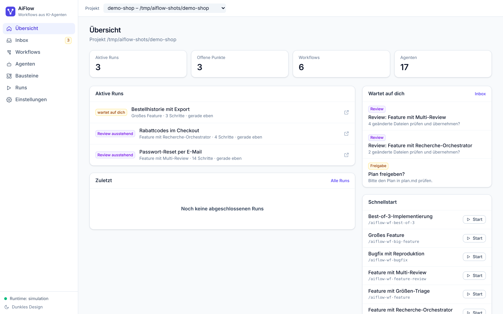 | **Workflow-Editor** 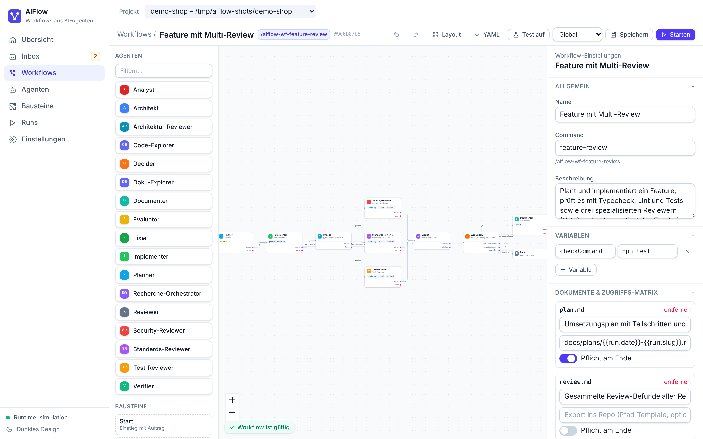 |
| **Zusammenführung mit Veto-Abstimmung** 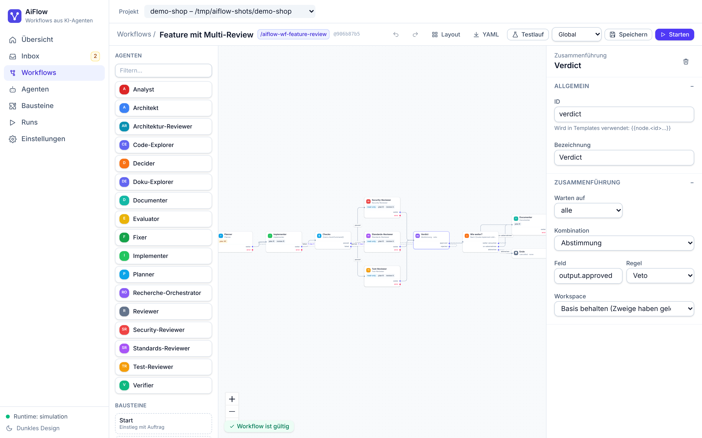 | **Agent-Knoten mit Sub-Agenten** 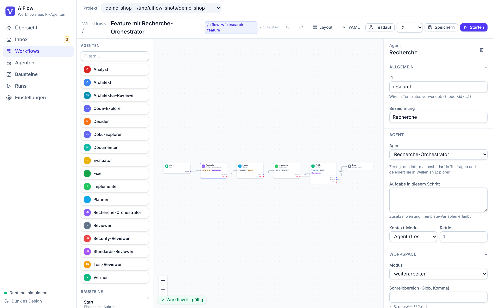 |
| **Run live: parallele Reviews** 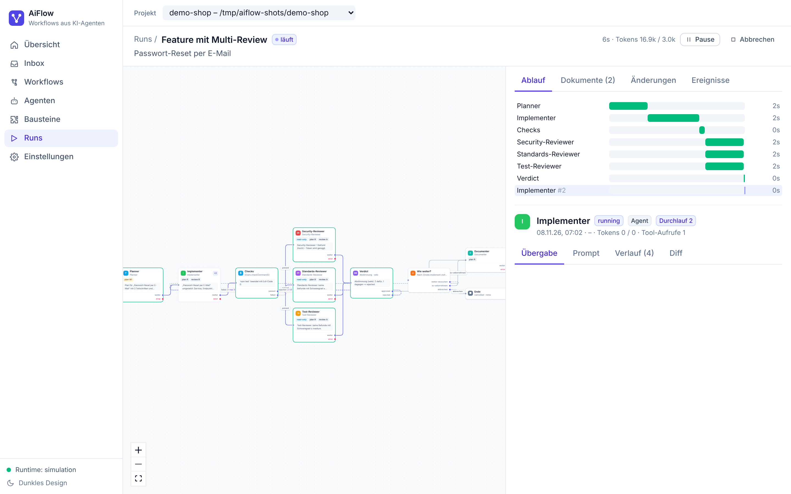 | **Schritt-Details: Veto → Schleife** 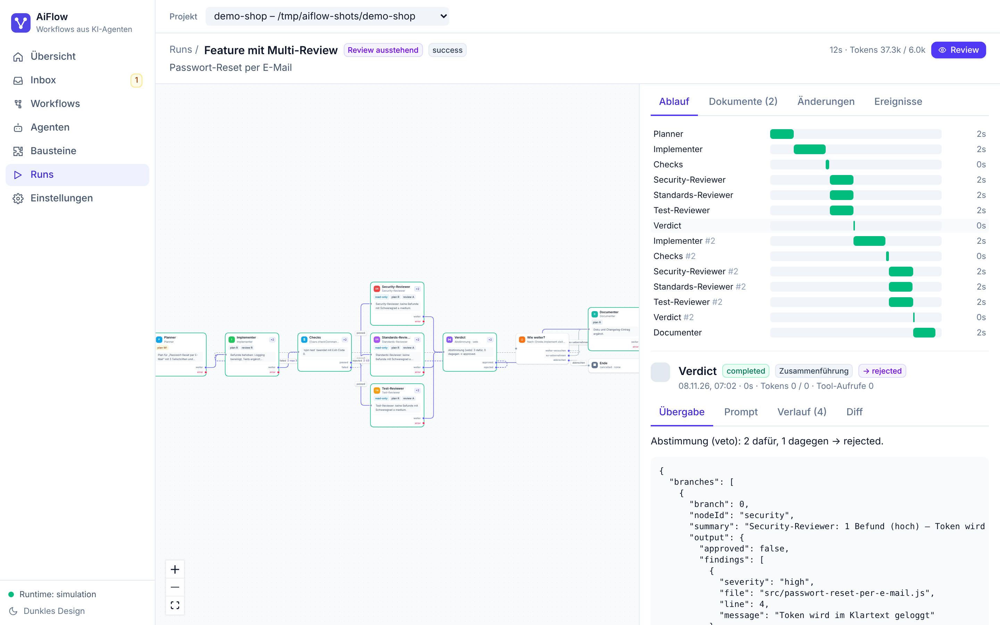 |
| **Exakter Prompt eines Schritts** 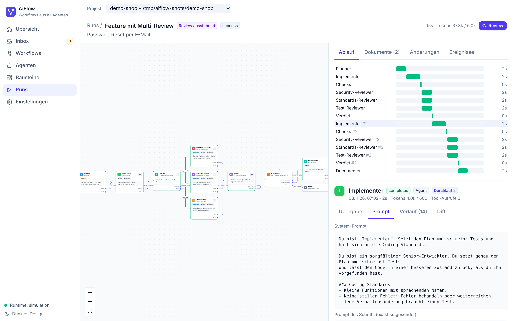 | **Sub-Agenten in Wellen** 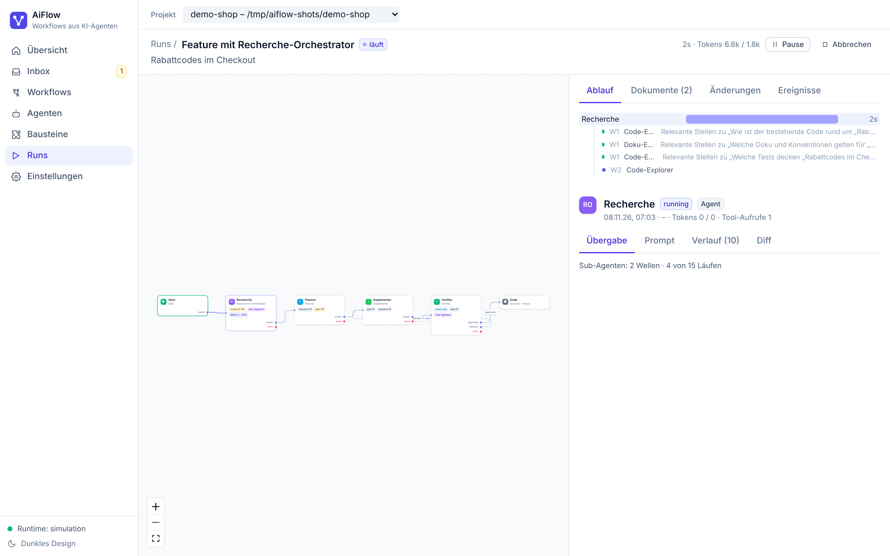 |
| **Review: Abschlussbericht** 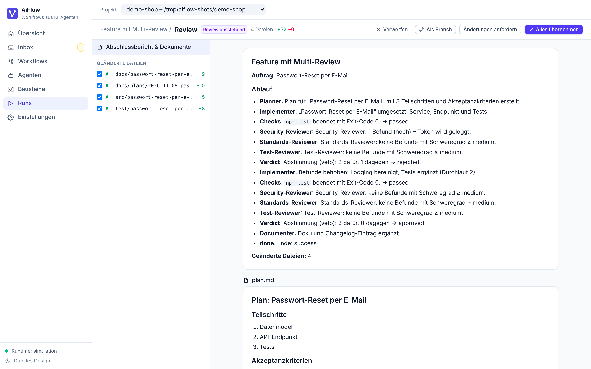 | **Review: Diff, Teil-Übernahme** 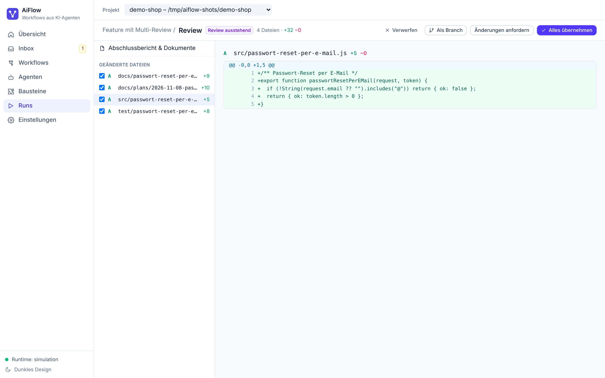 |
| **Inbox: Freigabe** 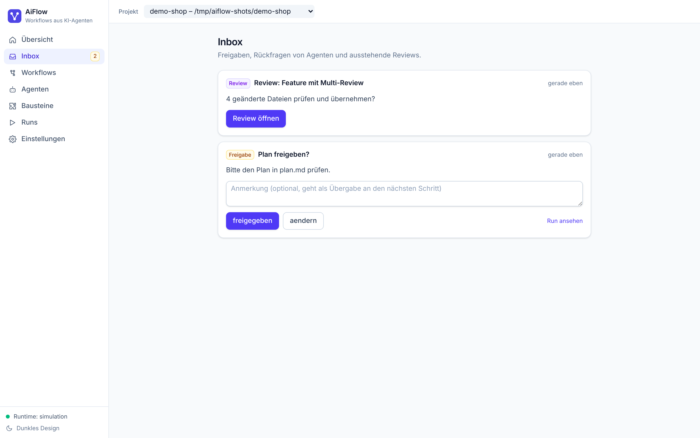 | **Testlauf ohne LLM** 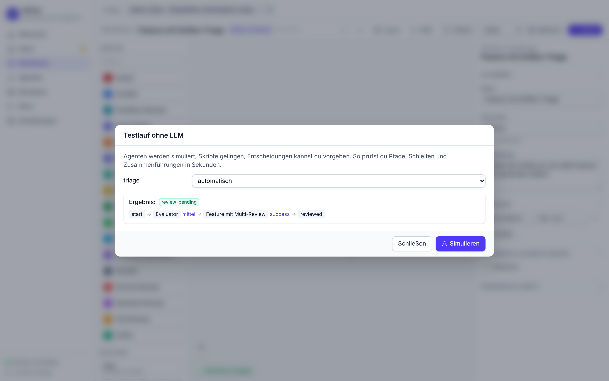 |
| **Agenten-Editor: Rechte** 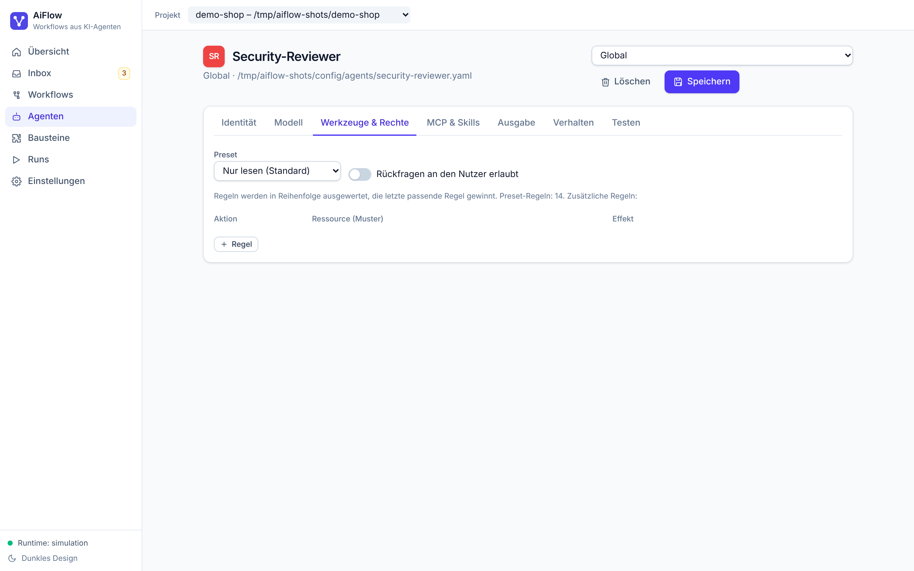 | **Agenten-Bibliothek** 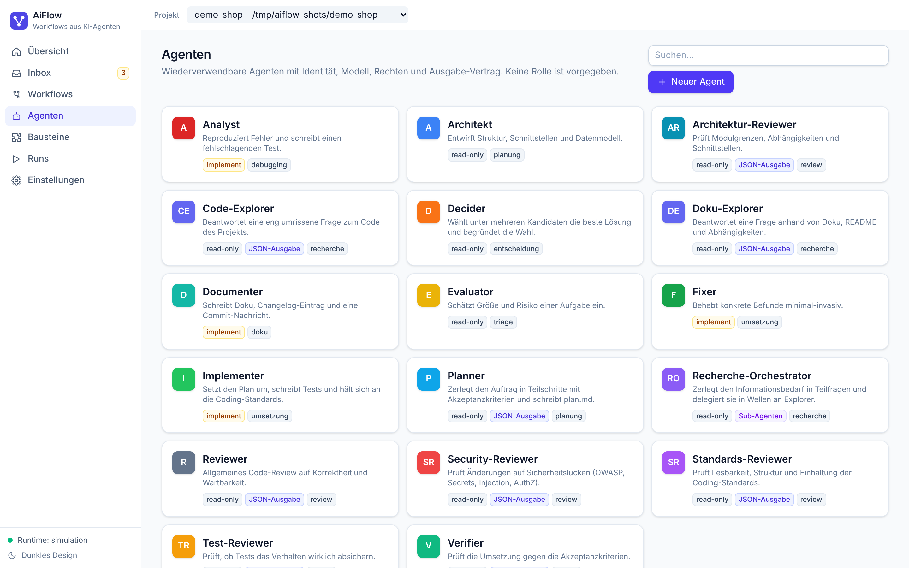 |
| **Run-History** 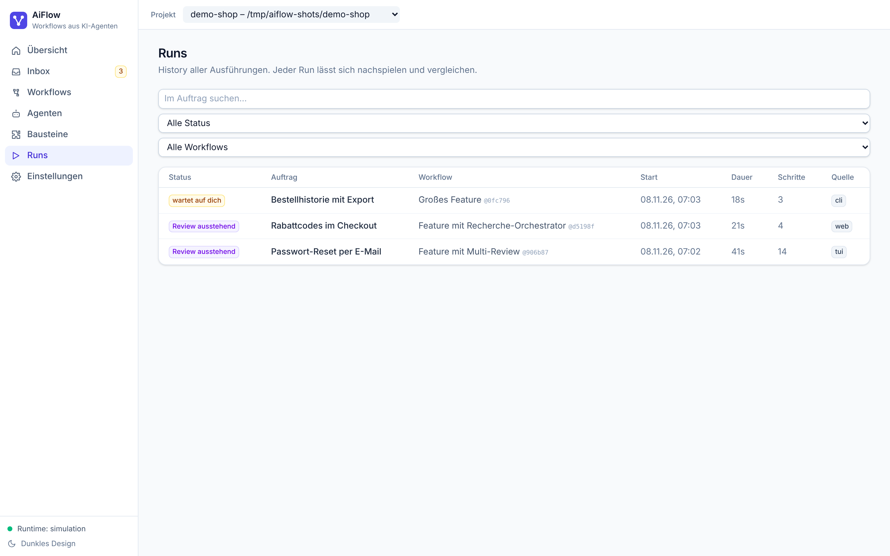 | **Dunkles Design** 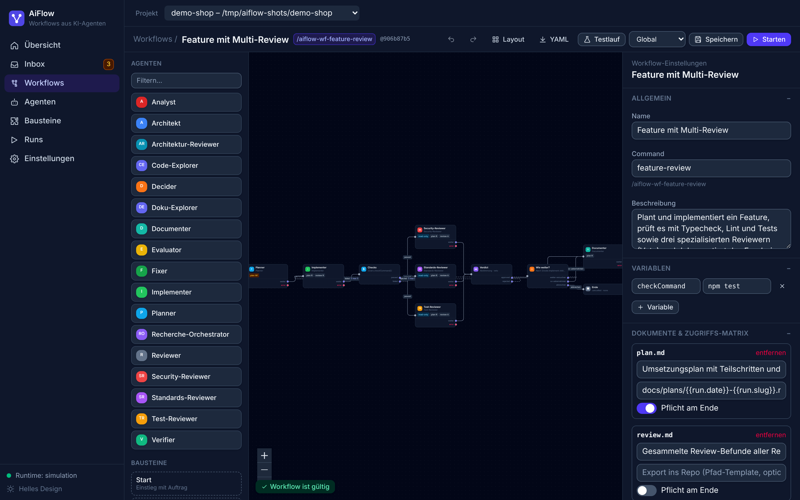 |
